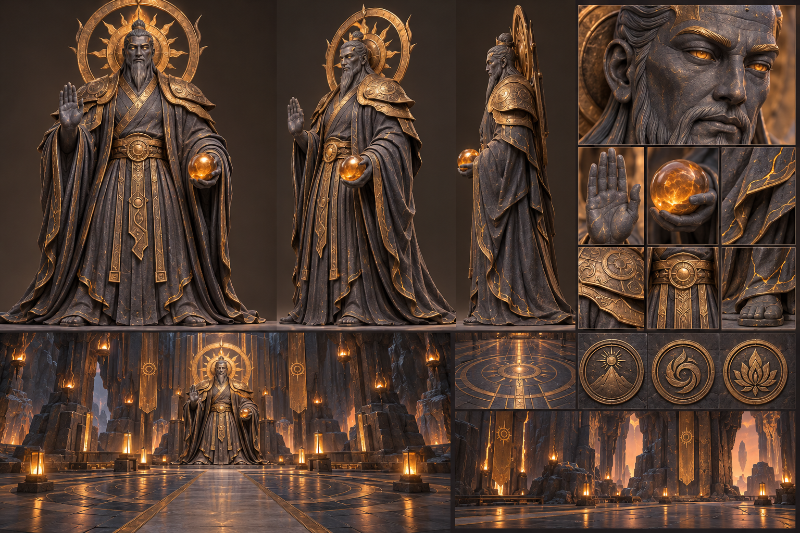

# 불꽃 수호자 전당 · 완성 기준

2026-10-21 / 목표: 세 방 시제품을 보상·퇴장까지 완성하고 본편 화산 신전에 연결한다.

목표 시안은 built-in imagegen으로 생성했다. [사용 프롬프트](reference-prompt.txt). 실제 Blender 결과와 같은 것으로 취급하지 않는다. 현무암 로브·청동 장식·명확한 얼굴과 손·태양 후광·호박빛 구슬을 기준으로 한다.

## 구현 계약

- 전당 x=-14..14, z=-57..-41, 바닥 y=3.2. 수호자 밑면은 자체 y=0, 몸체 약 4.5m·후광 포함 실측 5.048563m. 배치 (0,3.2,-53). 접근 지점 (0,3.2,-49.2). 장식이 보행면을 올리지 않는다.
- 증기실 상층 도착 기록과 두 앞선 잠금이 있어야 전당 문이 열린다. 경계가 겹치는 연결 바닥으로 실제 보행한다.
- 네 번째 정답 퍼즐을 붙이지 않는다. 세 문양과 실제 수호자·구슬·열린 손을 보여 주고 E로 말을 건다.
- 대화는 자동으로 넘어가지 않으며 E·탭·다음 버튼, 건너뛰기가 동작한다. 대화 중 이동과 장치 시간은 멈춘다.
- 마지막 대화가 끝나면 보상은 딱 한 번 기록한다. 구슬 상승 연출 후 입구 안전 바닥으로 자동 퇴장하고 밀봉한다. 중간 새로고침도 중복 지급·진행 소실 없이 복원한다.
- 시제품 기록은 본편 보상과 독립이다. 본편에서는 실제 화산 신전에 입장해 같은 세 방·전당을 진행하고 화산 구슬·수첩을 1회 갱신한다. 구형 본편 완료·다른 신전·채집·수첩을 보존한다.
- 구형 화산 기록은 원문을 `legacyFire`에 남기고 완료 구간을 새 방의 안전 완료 상태로 대응한다. 진행 중인 상태를 반쯤 적용하지 않는다.

## 완료 감사표

| 요구 | 필요한 근거 |
|---|---|
| 시안 기반 Blender 수호자·전당 | 편집 원본, 분리 GLB, 바닥·스케일 실측, 실제 동일 시점 렌더 |
| 세 방→전당 연속 진행 | 실제 이동 입력 완주·문 잠금·상층 통로 |
| 대화·1회 보상·자동 퇴장·밀봉 | 키보드·터치, 대화/연출 중 새로고침, 중복 방지 |
| 본편 연결 | index.html에서 실제 화산 입장·완주·구슬·수첩·퇴장·재접속 |
| 저장 호환 | 구형 각 진행/완료 이관, 원문·다른 자료 불변, 잘못된 데이터 전체 거부 |
| 재도전·안내·휴대폰 | 기존 검사·황금 가루 경로·낮은 화질·화면·터치 |
| 검증 신뢰성 | 새로운 종료/보상 고장 주입 실패, 기본·관련 회귀 통과 |

자동 기능 검사는 학생 재미와 실제 학생 기기의 성능을 입증하지 않는다. 그래픽은 실제 렌더로 시안과 비교하고 차이·남은 개선점을 보고서에 적는다. GitHub 업로드·배포는 이번 요청에서 명시되지 않았다.

2026-10-21 구현·검증 완료: [최종 보고서](../../../reports/2026-10-21/FIRE_ADVENTURE_COMPLETE.md). [시안·실제 GLB 비교](review.html).
