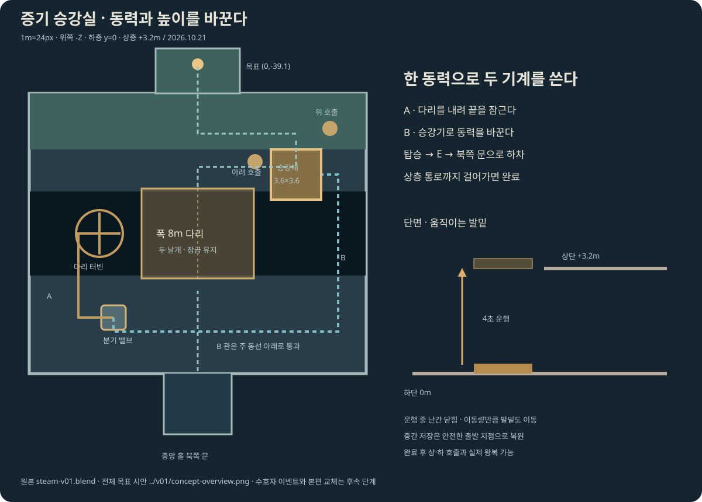

# 증기 승강실 · 제작 기준

2026-10-21 / [전체 목표 시안](../v01/concept-overview.png)과 [전체 도면](../v01/blueprint.svg)에 이어지는 세 번째 구간.

주조실에서 돌아오면 중앙 홀 북쪽 문이 열린다. 방은 x=-12..12, z=-37..-17, 바닥 y=0. 균열은 z=-30..-24, 바닥 -3m. 상층은 y=3.2m이며 우회 계단을 두지 않는다.

## 진행

1. 분기 밸브 (-6,-21)를 A로 돌린다. 닫힌 관의 표시와 터빈이 움직이며 힌지 다리(전체 폭 8m·길이 6.4m)를 내린다. 양쪽 4m 날개가 바깥 축에서 내려와 가운데를 잇는다. 처음에도 그 사이로 상층과 승강기를 볼 수 있다.
2. 약 2.2초 뒤 다리 끝의 톱니 잠금이 걸린다. B로 전환해도 내려간 다리는 유지된다. 내리는 중에 동력을 바꾸면 멈추고 A에서 이어진다.
3. B로 돌려 승강기에 동력을 보낸다. 다리를 직접 건너 승강대 (7,-31.2)에 탑승하고 E로 출발한다. 처음에는 사람이 없으면 상승하지 않는다.
4. 3.6×3.6m 승강대가 4초 동안 3.2m 올라간다. 발밑 높이와 같은 이동량을 적용한다. 이동 중 서쪽 탑승문과 북쪽 출입문이 닫히고, 뛰어도 난간 밖으로 나가지 않는다.
5. 상단에 멈추면 북쪽 문이 열린다. z=-33 경계를 넘어 상층 발코니, 중앙 통로의 목표 (0,-39.1)까지 걸어가야 세 번째 실험이 완료된다.
6. 완료 후에도 승강대의 E 왕복, 아래 호출 (4.1,-32.1)·위 호출 (9.4,-34.5)을 사용할 수 있다. 위쪽 빈 승강대 호출은 처음 탑승 상승을 경험한 뒤에만 가능하다.

## 보행·기록

- 같은 x,z라도 하층과 상층이 다르므로 현재 발 높이로 보행면을 선택한다. 발코니 아래 하층을 걸어도 3.2m 위로 순간 이동하지 않는다.
- 하단은 서쪽으로 타고 상단은 북쪽으로 내린다. 보이는 난간과 허용 이동 경계를 일치시킨다. 균열로 떨어지면 가까운 발판으로 돌아오며 잠근 다리를 보존한다.
- 운행 중 저장은 출발한 안전 정지점으로 복원한다. 다리도 내려가는 중이면 닫힌 안전 상태로 복원하고, 이미 잠근 다리와 완료 기록은 유지한다.
- 새 키 `mumuplanet.fire-trial.v2`로 확장한다. 기존 `mumuplanet.fire-trial.v1`을 읽어 이어받고 최초 쓰기 전 별도 사본도 보관한다. 구형 탭이 기록해도 새 진행을 덮어쓰지 않도록 예전 키를 수정하지 않는다. 본편과 최초 회랑 원문도 건드리지 않는다.
- 상층 전당 입구는 다음 단계의 닫힌 문으로 표시한다. 이번 작업에서 수호자 이벤트·구슬·본편 교체가 완료됐다고 보고하지 않는다.

## 모델과 검증

원본 지도·이전 두 방은 보존한다. 고정 건축·힌지 다리·터빈·승강대·출입 난간을 Blender GLB로 분리한다. 배관은 주 동선을 막지 않게 바닥 아래 또는 길 옆으로 연결한다. 다리 표면 0, 승강대 자체 밑면 기준 0, 상층 배치 3.2를 실측한다.

기능 검사는 실제 입력으로 세 방 연속 이동, 동력 전환과 다리 잠금, 빈 출발 거부, 탑승 운행·점프·발 밀착, 상층 도착·왕복 호출, 운행 중 저장·이전 기록 이관·수첩 정지·터치를 확인한다. 캐릭터 운반을 일부러 끊으면 발 밀착 검사가 실패해야 한다.
