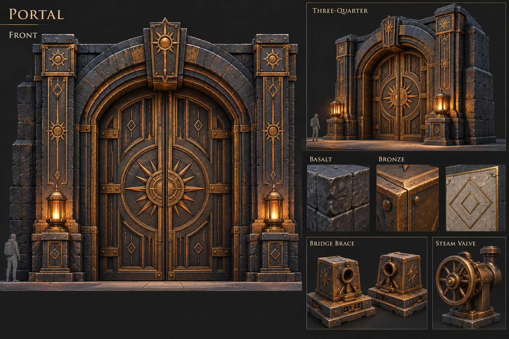
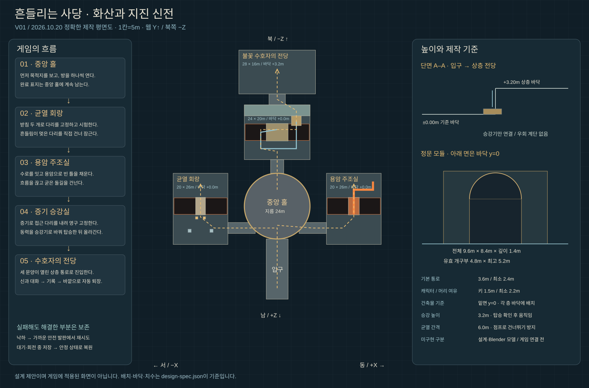

# 화산·지진 신전 V01 · 지도와 플레이 설계

2026-10-20~21 / 웹 Three.js / 설계·Blender 제작 및 세 구간 플레이 시제품

## 한 문장으로

**흔들리는 다리를 고정하고, 용암으로 길을 만들고, 증기의 힘으로 올라가 화산의 수호자를 만난다.**

현재 게임의 ‘흔들리는 사당’을 개편하는 설계다. 새 지도와 장치를 Blender로 제작하고 입구·중앙 홀·균열 회랑·용암 주조실·증기 승강실을 [별도 시제품](../../../fire-trial.html)에 연결했다. 기존 본편 로직을 새 설계로 교체한 상태는 아니다. 기존 코드·모델·저장 기록은 보존한다.

세 방의 운반·충전·냉각·증기 분기·탑승 상승·상층 통로를 구현했다. [최신 실제 화면·검증](../../../reports/2026-10-21/FIRE_STEAM_BUILD.md), [증기실 도면](../steam-v01/DESIGN.md), [주조실 도면](../foundry-v01/DESIGN.md). 현재 저장은 `mumuplanet.fire-trial.v2`이며 이전 두 방·회랑 원문은 유지한다. 수호자·본편 기록 이관은 후속 작업이다.

## 먼저 볼 이미지






생성 이미지는 공간의 인상과 조각·재질 목표다. 이미지에 보이는 수호상 옆 계단, 깊은 절벽, 과장된 크기가 그대로 이동 규칙이 되지는 않는다. 정확한 위치·높이·입구·잠금은 [design-spec.json](design-spec.json)과 평면도가 기준이다. 실제 모델 캡처에는 `blender-` 접두사를 쓴다.

## 기존 구성에서 바꾸는 이유

| 기존 웹 로직 | 문제 가능성 | 이번 방향 |
|---|---|---|
| 기둥 보호 고리 안에서 진동 버티기 | 멈춰 기다리기 반복. 실제 지진 안전 장소로 오해할 수 있음 | 눈앞의 신전 시험 장치를 관찰하고 받침을 배치해 구조를 안정시킴 |
| 지나온 육각 발판이 사라짐 | 실수 후 재시작 부담. 화산의 특징보다 경로 암기 비중이 큼 | 흐르는 용암을 틀에 모아 통행 가능한 돌길을 만듦 |
| 세 간헐천의 주기를 피해 이동 | 첫 방과 모두 ‘경고 보고 피하기’로 느껴질 수 있음 | 닫힌 관 안의 증기가 어느 기계를 움직일지 직접 전환 |
| 마지막 수로 세 조각 돌리기 | 그림자 신전의 거울 연결과 유사. 타이밍 잠금은 조작만 막기도 함 | 세 방에서 변화시킨 공간을 회수하고 승강 경로 끝에서 신과 만남 |

플레이 느낌은 아직 가설이다. 학생이 재미있어하는지, 원리를 이해하는지는 시제품과 실제 플레이로 확인한다.

## 전체 지도

```text
                 수호자 전당 +3.2m
                        ↑
               상층 연결 통로 +3.2m
                        ↑
                 증기 승강실 ±0m
                        ↑
균열 회랑 ←→       원형 중앙 홀       ←→ 용암 주조실
                        ↑
                  정문·입구 다리
```

- 기준 바닥은 y=0. 중앙 홀 지름 24m. 좌우 회랑은 각각 20×26m, 승강실 24×20m, 전당 28×16m.
- 세 방을 한꺼번에 열어 헤매게 하지 않고, 균열 → 주조 → 승강 순서로 연다. 막힌 다음 방에도 문양과 움직이지 않는 장치를 보여 앞으로 할 일을 예상하게 한다.
- 중앙 홀은 되돌아올 때마다 완료 문양이 하나씩 켜지는 기억의 기준점이다. 현재 방문할 문과 최종 목적지가 보인다.
- 선택 보상은 안전한 관찰 발코니에 둔다. 필수 해법·재료를 어두운 구석에 숨기지 않는다.
- 일반 동선 폭 3.6m, 최소 2.4m. 장치 앞은 반경 1.4m 이상의 회전·정지 공간. 캐릭터 키 1.5m, 머리 위 최소 2.2m.

## 방 1 · 균열 회랑 — 관찰하고 고정하기

**첫 화면:** 6m 균열 건너편의 봉인 문양, 살짝 흔들리는 돌다리, 가까운 쪽 받침 두 개와 비어 있는 고정구 두 개가 함께 보인다.

1. 안전 지점의 시험 손잡이를 작동하면 신전 장치가 다리를 한 번 흔든다. 기초의 빈 두 부분이 움직이는 모습을 보여 준다. 이때 캐릭터를 공격하거나 방 처음으로 밀지 않는다.
2. E로 받침을 들고 고정구에 넣는다. 돌·고정구의 접촉면과 홈이 맞물리는 실제 동작을 보여 준다. 단순히 정답 색을 따라 넣게 하지 않는다.
3. 두 고정구에 받침이 들어갔으면 다시 시험한다. 한쪽만 넣었을 때는 반대쪽이 움직이며 무엇이 부족한지 보인다.
4. 안정된 다리를 직접 건너 먼 쪽의 잠금 손잡이를 내려 완료한다. 받침을 꽂기만 해서는 문이 열리지 않는다.
5. 완료한 다리는 안전하게 유지된다. 같은 길로 중앙 홀에 돌아와 새 문양과 열리는 주조실을 본다.

| 상태 | 다음 조건 | 피드백 |
|---|---|---|
| loose | 받침 하나 배치 | 배치한 쪽은 멎고 반대쪽만 움직임 |
| braced | 받침 둘 + 시험 입력 | 장치 한 번 작동, 고정구가 하중을 받음 |
| testing | 시험 1.5초 종료 | 성공이면 진동 멎음, 실패면 흔들리는 부위 강조 |
| stable | 플레이어가 건너편 손잡이에 도착 | 기계식 영구 잠금 |
| latched | 완료 | 받침 회수 금지, 주조실 문 열림 |

중간 회수·실패는 꽂아 둔 받침을 지우지 않는다. 시험 중에는 새 배치가 예약되지 않는다. 움직이는 판과 받침 사이에 캐릭터가 끼지 않게 판정은 단순한 별도 면으로 둔다. 이 장치의 주기는 실제 지진 예측이나 대피 법칙이 아니다.

## 방 2 · 용암 주조실 — 흐름을 길로 바꾸기

**첫 화면:** 금속 수로의 끊긴 부분 두 곳, 아래의 비어 있는 다리 틀, 흐름을 조절하는 입구 밸브가 보인다. 조작점은 전부 입구 쪽 안전한 바닥에 있다. 건너야 조작할 수 있는 모순을 만들지 않는다.

1. 가까운 손잡이로 두 수로를 돌려 틀까지 흐를 경로를 만든다. 손잡이와 수로는 보이는 축·연결대로 연결한다.
2. 입구 밸브를 열면 연결된 곳까지만 용암이 흐른다. 잘못 연결한 흐름은 막힌 관의 배수 홈으로 돌아간다. 플레이어가 서 있는 바닥으로 쏟지 않는다.
3. 틀이 차면 용암은 여전히 뜨겁다. 그대로 건너면 안 되고 밸브를 닫아 추가 흐름을 끊어야 한다.
4. 공급이 끊기면 표면이 가장자리부터 어두워지고 마지막 잔열 문양이 꺼진다. 시제품의 냉각 시간은 4초로 시작하되 이는 신전 장치의 게임 시간 압축이다. 현실의 용암이 4초 만에 안전하게 굳는다는 설명을 하지 않는다.
5. 완성된 돌길을 건너 먼 쪽 문양을 잠근다. 이후 돌길은 부서지거나 다시 녹지 않는다.

상태: `empty → routing → filling → hot → cooling → solid → latched`.

완료 조건은 **틀의 정량 충전 + 공급 차단 + 냉각 완료 + 건너편 도착**이다. 기다리기만 해서 풀리지 않고, 수로 한 번 돌리기로도 끝나지 않는다. 틀은 초과 충전되지 않는다. 밸브를 다시 열면 공급 중이라는 시각 피드백을 주고, 고체 다리를 지우는 방식으로 벌하지 않는다.

## 방 3 · 증기 승강실 — 동력을 선택하기

**첫 화면:** 왼쪽의 큰 회전 날개, 두 갈래로 나뉜 닫힌 관, 내려오지 않은 접근 다리, 오른쪽의 승강기, 위에 보이는 전당 문을 한 시야에 배치한다.

1. 가까운 분기 밸브를 A 방향으로 돌린다. 관의 압력 표시가 움직이고 회전 날개·감속기가 돌아 접근 다리를 내린다.
2. 다리가 내려가면 끝의 톱니 잠금이 걸린다. 동력을 바꾸어도 다리는 올라가지 않는다.
3. 밸브를 B 방향으로 돌려 승강기 쪽에 동력을 보낸다. 준비 표시가 켜지되 플레이어 없이 승강기가 먼저 떠나지 않는다.
4. 다리를 건너 승강기에 탑승하고 E로 출발한다. 높이 3.2m까지 서서히 이동한다. 위의 내림 손잡이와 아래 호출 장치를 모두 마련한다.
5. 상층에 발을 디디면 통로가 잠금 해제된다. 완료한 승강기와 연결 다리는 안전한 왕복 수단으로 남긴다.

상태: `bridge_closed → bridge_moving → bridge_latched → lift_ready → ascending → upper_latched`.

승강 구간에 캐릭터를 그냥 y좌표로 올려 버리는 방식은 피한다. 탑승 여부·바닥 속도·상하 정지점을 따로 판정한다. 움직임 중에는 장치에 저장 요청이 와도 안정된 정지점으로 스냅샷을 만든다. 장식 계단이 상층으로 바로 연결되어 퍼즐을 우회하면 안 된다. 눈에 보이는 흰 김은 응결한 작은 물방울이며, 기체 수증기 자체가 흰 연기라는 표현은 쓰지 않는다.

## 전당 · 세 행동의 결과를 되돌려 받기

- 새 암호나 네 번째 조작을 추가하지 않는다. 중앙 홀에서 보았던 세 문양이 전당 문에서도 같은 순서로 켜진다.
- 받침으로 만든 안정, 용암에서 얻은 돌길, 증기로 얻은 높이를 지나 도착했다는 보상을 큰 시야·조명·소리의 변화로 준다.
- 수호자는 최종적으로 조각할 인물 모델이다. 현재 Blender의 의자·후광은 배치와 스케일을 잡는 건축 장치이며 완성된 신 모델이라고 부르지 않는다.
- E 대화 → 구슬과 기록 1회 지급 → 신전 밖 안전 지점으로 이동 → 완료 밀봉. 저장 후 다시 들어올 때 중복 지급하지 않는다.

## 조작과 안내

- 이동·달리기·점프는 기존 조작을 유지한다. 상호작용은 E/터치 하나. 들기·놓기·돌리기·출발은 가까운 대상을 명확히 표시한다.
- 상단에는 지금 해야 할 목표 하나. 수첩에는 발견한 원리와 기록을 남긴다. 황금 가루는 요청했을 때 장치·공간 방향만 안내한다.
- 힌트는 ‘관찰할 곳 → 인과관계 → 구체 행동’ 3단계. 성공 버튼의 순서를 항상 화면에 쓰지 않는다.
- 무음에서도 장치의 움직임·관의 표시·구조의 변화로 읽힌다. 색만으로 분기·위험·완료를 구분하지 않는다.

## Blender 제작 규칙

| 단계 | 실제 산출물 | 통과 기준 |
|---|---|---|
| 설계 이미지 | 전체 콘셉트·정문 시안·정확한 평면/단면 | 방 수·연결·높이·우회 경로 점검 |
| 1차 제작 | 전체 지도·정문·균열/수로/승강기 구조 | 바닥·경로·개구부의 수치 검사, 실제 모델 렌더 |
| 보행 시제품 | 별도 Three.js 새 방 + 단순 충돌면 | 실제 입력으로 이동·재시도·장치 접근·높이 이동 |
| 마감 | 석재 부서진 모서리·문양·그을음·마모·증기·용암 | 같은 시점에서 시안과 비교, 어두운 물체 실루엣 분리 |
| 최적화·저장 | 재질 배치·LOD·새 방 저장 버전 | 격리 브라우저 복원·구형 기록 보존, 학생 기기 성능 |

건축물은 로컬 y=0에서 만든다. 상층 건물도 자체 밑면 y=0을 갖고 배치 시 +3.2m를 적용한다. 이번 전체 지도는 배치 검수용으로 각 층 높이를 적용해 저장했다. 게임용 개별 모듈을 만들 때는 자체 바닥 원점을 다시 분리한다. 문짝과 승강대·수로도 고정 건축물과 별도 이름/원점을 갖게 분리해야 한다. 현재 검수 GLB는 정적 공간을 재질별로 합친 것이므로 그대로 동적 장치 제어에 쓰지 않는다.

크기는 거대한 시안 인상에 끌려 키우지 않는다. 기둥의 굵기·문양은 1.5m 캐릭터와 실제 카메라에서 확인한다. 안개와 주황 발광으로 모든 것을 가리지 않는다. 돌산은 주상절리·층리의 큰 덩어리로 잡고 둥근 덩어리를 늘어놓지 않는다.

## 저장과 새 구조 연결 계획

`FireAdventure`를 별도 모듈로 구현하고 새 불 신전 내부 버전을 둔다. 전역 키 `mumuplanet.progress.v1`은 유지한다. 기존 `FireGates.js`와 구형 상태는 실행 경로를 교체한 뒤에도 이관 근거로 보존한다.

- 구형 원본은 `legacyFire` 사본으로 보관. 구슬·완료·다른 신전은 유지.
- 움직이는 다리·운반 중 받침·뜨거운 흐름은 검증된 안정 상태로 직렬화. 위험한 곳에서 바로 복원하지 않는다.
- 방 완료, 실제 통행 상태, 문 잠금이 분리되어 닫힌 문에 갇히지 않게 동일 계약으로 복원.
- 데이터 전체를 검증한 뒤 적용한다. 일부 적용 후 오류로 사용자 기록을 덮어쓰지 않는다.

## 비판적 검토와 확인할 것

1. **왕복이 지루해질 수 있다.** 좌우 왕복은 홀에서 새 변화가 눈에 띄도록 하고, 완료 구역의 안전한 지름길은 시제품 플레이 시간을 본 뒤 결정한다.
2. **두 받침 넣기가 너무 자명할 수 있다.** 시험 후 움직이는 부위를 먼저 관찰해야 이유를 알게 한다. 슬롯 형태만 보고 꽂고 끝나는 플레이가 많으면 받침 위치/하중 기믹을 조정한다.
3. **수로 조작이 거울 퍼즐의 재탕이 될 수 있다.** 목표는 연결 정답 자체가 아니라 ‘흐름을 멈춰 새 바닥을 얻는 것’으로 잡는다. 어려움을 수로 개수 증가로 해결하지 않는다.
4. **증기 밸브가 단순 순서 버튼일 수 있다.** 동력 경로, 영구 잠금, 탑승 조건이 실제 공간에서 보이는지 먼저 본다. 메뉴나 숫자 게이지로 설명을 대신하지 않는다.
5. **그림은 장대하지만 실제 GPU 성능은 별개다.** 전체 지도를 한 번에 그리지 않도록 구역 가시성·재질 배치·저해상도 VFX를 준비한다. 목표는 학생 기기의 안정적인 조작이며 현재 FPS를 측정한 것은 아니다.
6. **콘셉트 계단은 해법을 무너뜨릴 수 있다.** 실제 도면의 승강실은 우회 계단이 없다. AI 시안이 치수와 충돌을 보장한다고 간주하지 않는다.

초기 재미 점검은 해법을 알려주지 않은 학생 5명 정도로 한다. 각 방에서 무엇을 해야 하는지 말할 수 있는가, 1분 이상 수동적으로 기다리는가, 힌트 없이 인과관계를 발견하는가, 실패 후 다시 시도하는가를 기록한다. 자동 검사가 재미·학습 효과를 입증하는 것은 아니다.

## 참고 근거

- [Nintendo 개발자 인터뷰 Part 3](https://www.nintendo.com/us/whatsnew/ask-the-developer-vol-9-the-legend-of-zelda-tears-of-the-kingdom-part-3/): 높이를 이용한 탐험, 지역별 던전의 개성, 공간 규모와 시인성 조정. 본 설계에서는 테마가 보이는 동선과 상층 목표로 적용했다.
- [Nintendo 개발자 인터뷰 Chapter 5](https://www.nintendo.com/au/news-and-articles/ask-the-developer-vol-9-the-legend-of-zelda-tears-of-the-kingdom-chapter-5/): 실험과 발견의 즐거움. 여러 가설을 안전하게 시도하고 결과를 관찰하도록 구성한다.
- [USGS · 화산의 성질](https://pubs.usgs.gov/gip/volc/nature.html): 용암은 냉각·고화하며 색과 성질이 변한다. 신전의 빠른 주조 시간은 게임적 압축이다.
- [USGS · 화산과 간헐천의 관계](https://www.usgs.gov/faqs/what-relationship-between-volcanism-and-geysers-and-hot-springs-yellowstone): 마그마의 열과 화산 가스가 위의 물을 데우는 열수계를 설명한다. 증기 동력 장치는 이를 활용한 허구의 신전 설비다.

원문을 복제한 던전이나 과학 실험 시뮬레이터가 아니라, 위 근거를 바탕으로 한 이 게임의 제작 제안이다.
