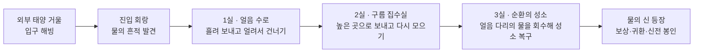
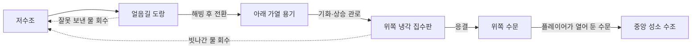

# 물의 신전 내부 기획안 v01

작성: 2026-09-24 · 상태: 협의용 제안, 구현 전

## 한 줄 콘셉트

**같은 물을 얼려 길을 만들고, 녹여 흐르게 하고, 수증기로 높은 곳까지 보낸 뒤 다시 모아 잠든 성소를 깨운다.**

외부 태양 거울은 입구를 여는 도입부다. 내부는 상태 변화가 실제 지형과 이동 경로를 바꾸는 세 개의 퍼즐 방으로 구성한다. 초등 고학년 기준으로 우선 설계하되 연령과 숙련도에 맞춰 조정한다. 첫 플레이 20~30분은 제작 목표이며 아직 실측하지 않았다.

## 현재 상태와 개선 이유

- Unity에는 외부 돌산·거울·입구 해빙까지 구현돼 있다. 내부는 이 계획의 신규 작업이다.
- 기존 웹 `src/shrine/WaterPhases.js`에는 얼음 다리, 응결 집수, 종합 복구가 있다. 가열·냉각·집수판 상태를 맞추면 수치가 증가하는 구조다.
- 이 개념은 유지하되, 장치 순서를 외우는 퍼즐에서 **공간 관찰 → 경로 선택 → 상태 변화 → 이동 → 물 재사용**으로 바꾼다.
- 기존 코드의 `bridgeReady` 같은 과거 성공 기록만으로 물이 생성되거나 길이 열리도록 하지 않는다. 현재 물의 위치·상태와 실제 장치 연결이 결과를 결정한다.

## 플레이의 공통 규칙

| 물의 모습 | 플레이에서 하는 일 | 알아볼 수 있는 표현 |
|---|---|---|
| 얼음 | 도랑을 건너는 발판, 수로를 막는 마개 | 두께·서리·금 간 소리, 완전히 얼면 발 디딤 표시 |
| 물 | 낮은 수로로 흐르고 수조를 채움 | 물살·떠가는 조각·수위선 |
| 수증기 | 가열 용기에서 위쪽 관으로 이동 | 가열 소리·관의 맥동·이동 방향 표시 |
| 다시 모인 물 | 차가운 집수판에서 물방울이 되어 떨어짐 | 맺힘 → 방울 → 물받이 → 수위 상승 |

물 자체의 상태와 주변 장치를 구분한다. 물이 높은 곳으로 저절로 흐르지 않는다. 높은 곳으로 옮길 때는 가열 용기와 증기 관로가 있어야 한다. 얼음 다리는 양쪽 지지턱이 있는 얕은 도랑에 형성되어 공중에 떠 있지 않는다.

수증기는 눈에 보이지 않으며 흰 김은 작은 물방울이다. 게임의 흰 김은 안내 연출로 쓰되, 수첩에서 이 차이를 짧게 설명한다. 급속 냉각·가열은 신전 장치의 판타지 기능이고 소요 시간은 게임에 맞게 압축한다.

### 조작

- 가까이 가서 E: 밸브 잡기, 장치 사용, 손 놓기.
- 장치를 잡으면 좌우로 연결 방향 선택. 자유 회전보다 명확한 연결 위치에 걸리는 방식으로 시작한다.
- 가열/냉각 장치는 선택한 대상에 지속 작동한다. 아무 물이나 즉시 얼리는 전능한 마법은 주지 않는다.
- 장치는 불꽃·눈꽃·방향 모양과 움직임을 함께 사용한다. 색만 보고 구별하게 하지 않는다.
- 첫 방에서만 조작을 직접 안내한다. 이후에는 목표와 관찰 결과를 보여 준다.

## 전체 동선

출구와 주요 목표는 입구에서 보이게 한다. 장치는 물이 이동하는 경로 옆에 둔다. 각 방은 입구 → 관찰 지점 → 실험 장치 → 바뀐 길 → 출구 순서로 읽혀야 한다.

## 1실 — 얼음 수로: 길을 직접 만들기

**퀘스트: 끊어진 회랑을 건너 수문을 열어라.**

### 공간

- 시작 쪽: 얼음으로 막힌 저수조, 가열 반사경, 두 갈래 수로 전환기.
- 가운데: 지지턱이 있는 넓은 도랑과, 출구에 닿지 않는 짧은 측면 도랑.
- 반대쪽: 출구 수문과 영구적으로 내릴 수 있는 돌아오는 다리.
- 냉각 장치는 물이 있는 도랑을 선택해 얼릴 수 있다. 두 도랑의 목적지는 높은 관찰 발판에서 모두 보인다.

### 권장 해결 흐름

1. 막힌 저수조를 녹여 물이 흘러나오게 한다.
2. 출구까지 이어지는 도랑으로 수로를 돌린다.
3. 필요한 양의 물이 찬 다음 그 도랑을 냉각한다.
4. 얼음길을 직접 건너 수문을 열고, 돌아오는 다리를 내린다.

**생각할 지점:** 물이 없는데 냉각해도 다리는 생기지 않는다. 잘못된 도랑을 얼리면 발판은 만들어지지만 출구까지 연결되지 않는다. 그 얼음을 녹여 물을 돌려보낸 뒤 다시 시도할 수 있다.

단순한 숨은 정답 찾기가 되지 않도록 도랑의 길이와 도착점을 명확히 보여 준다. 첫 방에는 강제 시간제한·녹는 다리 위 정밀 점프를 넣지 않는다. 잘못된 경로는 짧은 수첩 그림을 발견하는 선택 탐험으로도 사용한다.

**완료 조건:** 유효한 얼음길을 통해 반대쪽에 도착해 수문을 실제로 개방. 단순히 냉각 버튼을 누른 횟수로 판정하지 않는다.

## 2실 — 구름 집수실: 올라갈 수 없는 물을 올리기

**퀘스트: 위층 수조에 물을 모아 회랑 다리를 올려라.**

### 공간

- 아래층: 물이 든 가열 용기와 물이 올라가지 못하는 높은 수조.
- 접근 가능한 측면 관리 계단: 증기 관로 전환기와 집수판 조작대.
- 위쪽: 두 관로 끝, 이동 가능한 차가운 집수판, 목표 수조로 이어지는 물받이.
- 출구 앞: 수조 안 부표와 연결된 경첩 다리. 수위가 오르면 부표가 다리를 통행 높이로 올리고 잠금 장치가 고정한다.

### 권장 해결 흐름

1. 높이 차이 때문에 액체 상태로는 수조까지 갈 수 없음을 관찰한다.
2. 가열 용기에서 수증기를 만들고 목표 쪽 관로로 보낸다.
3. 그 관로 끝으로 집수판을 옮겨 냉각한다.
4. 응결된 물방울이 목표 물받이 안으로 떨어지도록 위치를 맞춘다.
5. 수조가 차면서 올라온 다리를 건너 출구에 도착한다.

**생각할 지점:** 가열만 해서는 목표 수조가 차지 않는다. 차가운 판이 있어도 관로 끝과 어긋나면 모이지 않고, 물방울이 생겨도 물받이를 빗나가면 아래 회수조로 돌아간다.

세 장치를 멀리 흩어 놓지 않는다. 관리 계단에서 증기 출구·집수판·물받이를 한눈에 비교할 수 있게 배치한다. 긴 왕복과 작은 각도 맞추기 대신 원인과 결과를 관찰하는 데 집중한다. 관로 위치는 2개, 집수판 위치는 3개부터 시작한다.

**완료 조건:** 목표 수조의 실제 물이 기준 수위에 도달하고 다리의 통행 상태가 확보된 뒤 출구 도착. 다리가 먼저 올라가 플레이어가 타지 못하는 승강기 문제는 만들지 않는다.

## 3실 — 순환의 성소: 만든 길을 다시 물로 쓰기

**퀘스트: 끊어진 물의 순환을 복구해 성소를 깨워라.**

중앙 성소의 빈 수조와 위쪽 닫힌 수문을 처음부터 함께 보여 준다. 제한된 물을 한 번의 순환으로 재사용하는 방이다. 임의의 숫자 맞추기나 새로운 장치 규칙은 추가하지 않는다.

### 공간과 물의 경로

### 권장 해결 흐름

1. 저수조의 물로 도랑을 채우고 얼려 반대편 회랑에 접근한다.
2. 직접 건너가 위쪽 수문을 열고 냉각 집수판을 준비한다.
3. 그곳에서 **돌다리 지름길을 내린다.** 이제 얼음길 없이 돌아올 수 있다.
4. 돌아와 얼음길을 녹이고, 그 물을 아래 가열 용기로 돌린다.
5. 수증기를 위로 보내고 차가운 판에서 다시 물로 모은다.
6. 열린 수문을 통해 중앙 성소 수조에 물이 모이면 마지막 문이 열린다.

**핵심 발견:** 얼음길에 물을 남겨 두면 성소를 채울 물이 부족하다. 길을 만든 뒤 다른 안전한 길을 확보하고, 처음의 물을 되돌려 써야 한다.

이 과정은 숨은 순서 플래그로 강제하지 않는다. 먼저 가열해도 수문이 닫혀 있으면 물이 회수조로 되돌아오는 실제 연결 구조를 따른다. 올바른 장치 상태와 경로를 만들면 다른 조작 순서도 허용한다.

### 막힘과 재도전 방지

- 건넌 편에서 돌다리 지름길을 항상 내릴 수 있다. 밸브 조작 후 도랑을 녹였다고 외딴섬에 갇히지 않는다.
- 모든 빗나간 물은 회수조로 간다. 물이 허공으로 영구 소실돼 재시작해야 하는 상황을 만들지 않는다.
- 표준 난이도는 증기 누출이 없는 닫힌 회로로 구성한다. 물 양은 실제 질량 대신 일관된 게임 단위로 추적하고, 상태가 바뀌어도 총량을 유지한다.
- 수조 목표량은 회수 가능한 총량 안에서 정한다. 표시 반올림 때문에 99%에서 멈추지 않게 한다.
- 물속에 떨어지면 최근 안전 발판으로 돌아온다. 이미 개방한 지름길과 수문은 유지한다.

## 피날레

성소에 물이 모이면 바닥 문양을 따라 물빛이 퍼지고, 얼어 있던 벽의 물줄기가 다시 흐른다. 물의 신은 플레이어가 복구한 순환의 중앙에서 등장한다.

짧은 대사: “길이 되었던 얼음을, 다시 흐르는 물로 돌려주었구나.”

보상과 수첩 기록을 먼저 저장한다. 이후 안전한 외부 귀환 위치로 이동하고 신전을 봉인한다. 연출 중 종료·재접속해도 보상을 중복 지급하거나 캐릭터가 봉인된 방에 갇히지 않아야 한다. 다시 보기/재도전 허용 여부는 별도로 정한다.

## 퀘스트·수첩·힌트

- 메인 퀘스트는 한 문장으로 목표만 보여 준다. “가열 → 냉각 → 밸브”라는 정답 순서를 상시 표시하지 않는다.
- 퀘스트 클릭 시 황금가루는 관찰 위치나 현재 접근 가능한 장치까지 안내한다. 벽을 뚫고 목적지로 직진시키거나 해결 전 얼음길을 건너게 하지 않는다.
- 수첩에는 방의 간단한 물길 그림, 직접 발견한 성질, 장치 상태를 읽기 쉬운 글씨로 기록한다.
- 힌트는 사용자가 요청하면 3단계로 제공한다: 볼 곳 → 원리 → 다음 행동.
- 실패 피드백은 원인을 보여 준다: “물이 없어 얼지 않는다”, “물방울이 회수조로 떨어진다”, “위쪽 수문이 닫혀 있다”.
- 해결 후 개념 용어는 짧게 정리한다. 설명문 읽기와 퀴즈 답하기를 문 개방의 필수 조건으로 두지 않는다.

## 난이도 제안

| 설정 | 관찰·선택 | 조작 부담 |
|---|---|---|
| 도움 | 물길 강조, 필요한 장치 표시, 힌트 바로 사용 | 자동 맞춤 범위 넓음, 점프 최소 |
| 기본 — 우선 제작 | 대체 경로 존재, 원인 피드백 제공 | 시간제한 없음, 짧은 이동·명확한 연결 위치 |
| 도전 — 후속 검토 | 물 분배 경로 추가, 선택 보상실 | 선택 구간만 시간 요소; 필수 퍼즐을 속도 시험으로 바꾸지 않음 |

세 난이도를 처음부터 별도 제작하지 않는다. 기본 한 가지를 먼저 플레이테스트하고 실제 막히는 지점을 보고 조정한다.

## 2~3인 협동 확장

혼자 모든 장치에 접근해 해결할 수 있는 구조를 먼저 만든다. 협동에서는 수로 담당·가열 담당·상층 관찰 담당으로 나눠 대화할 이유를 만든다. 다른 사람이 동시에 버튼을 눌러야만 진행되는 구간은 필수 동선에 두지 않는다.

협동 도입 시 물의 양·상태·밸브·문은 방의 단일 권한 주체가 관리한다. 같은 물을 두 명이 동시에 이동시키거나 장치를 붙잡아 복제하는 문제를 검증한다. 현재 Unity 내부 협동이 구현됐다는 의미는 아니다.

## 디자인과 구현 순서

1. **1실을 간단한 블록으로 제작:** 물 경로 선택, 얼림·해빙, 건너기, 실패 회수까지 연결한다.
2. **처음 보는 사람의 플레이 확인:** 설명 없이 목표를 찾고, 실패 원인을 이해하고, 다시 시도하는지 관찰한다.
3. **세 방의 평면·단면과 레퍼런스 제작:** 입구에서 보이는 목표, 바닥 높이, 장치 위치, 물의 고저차, 지름길을 확정한다.
4. **확정 동선에 맞춰 Blender 미술 제작:** 바닥 Y=0, 기단·문턱·배수로 규격을 공유한다. 보기 좋은 렌더 때문에 실제 길을 바꾸지 않는다.
5. **2실 → 3실 → 피날레 연결:** 새 규칙을 늘리기보다 앞에서 익힌 규칙을 조합한다.
6. **로컬 저장·귀환·선택 힌트·협동 순으로 확장.**

미술 제작은 승인된 레퍼런스와 같은 카메라 위치에서 비교한다. 낮은 정면·측면에서 접지를 확인하고, 플레이어 시점에서는 길과 장치가 읽히는지 따로 확인한다.

## 구현 방법과 검증 기준

실시간 유체 전체를 계산하지 않는다. 저수조·도랑·가열 용기·집수판·목표 수조를 연결하고 물의 양과 상태를 계산한다. 흐르는 물과 김은 그 계산 결과를 보여 주는 연출이다. 한 상태가 동시에 물·얼음으로 중복 집계되지 않도록 한다.

물길 연결 → 물 이동 → 상태 변화 → 지형 충돌 갱신 → 퀘스트/저장 순으로 책임을 분리한다. 시각 효과만 변하고 발판 충돌이 남거나, 문이 열렸는데 진행 기록이 닫힌 상태인 오류를 검사한다.

### 기능 검사

- 빈 수로는 얼지 않는다. 얼음을 녹이면 같은 양의 물을 회수한다.
- 잘못된 관로·집수판·수문 조합에서는 목표 수조가 증가하지 않는다.
- 정상 경로의 물은 두 수조에 중복 집계되지 않는다.
- 부분 해빙 중 플레이어 아래 충돌이 갑자기 사라지지 않도록 사전 표시와 안전 복귀를 제공한다.
- 각 방의 잘못된 조작 순서와 중도 저장/불러오기를 검사한다.
- 마지막 방에서 지름길 확보 없이 물을 회수하더라도 복구 가능한 수단이 남아 있어야 한다.
- 저성능 설정에서도 흐름 방향·빙결 완료·물받이 위치가 보인다.

### 재미 검사 — 자동 테스트와 분리

- 목표를 찾는 데 시간이 과하게 걸리는가?
- 아이가 “왜 안 되는지” 자신의 말로 설명하고 다음 시도를 선택하는가?
- 버튼을 무작위로 눌러 우연히 통과하는가, 공간을 보고 해결하는가?
- 기계 앞에서 할 일 없이 기다리는 시간이 긴가? 작동 중 이동·관찰할 일이 있도록 조정한다.
- 3실에서 얼음길을 물로 재사용해야 한다는 발견이 자연스럽게 일어나는가?

**이번 합의 제안:** 세 방 구성과 마지막 방의 물 재사용을 핵심으로 잡고, 다음 실제 작업은 1실의 플레이 가능한 시험 버전부터 진행한다.
