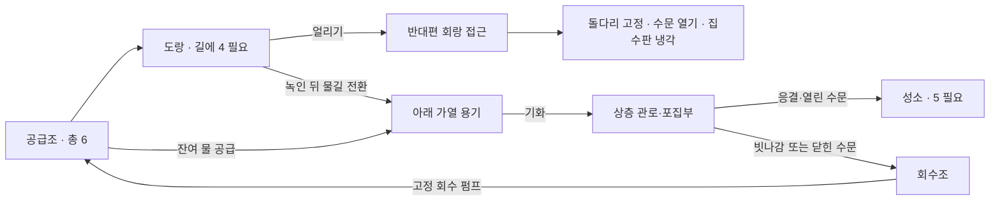

# 물의 신전 상세 계획 v03 — 물의 팔찌

2026-09-24 · 협의용 상세 설계 / 구현 전

사용자 합의: 신전에 숨겨진 물의 팔찌를 발견하고, 팔찌로 물의 상태를 바꾸며 진행한다. 기존 v01·v02 및 비판 검토는 보존한다. 본 문서가 새로운 제작 기준안이다. 구체적인 거리·시간·수량은 시험값이며 아직 플레이테스트로 확정하지 않았다.

## 1. 플레이의 중심

**팔찌는 물의 모습을 바꾸고, 플레이어는 그 물의 위치와 용도를 바꾼다.**

- 획득의 즐거움: 신전의 흔적을 따라가 직접 팔찌를 찾아 착용한다.
- 능력의 손맛: 캐릭터가 손을 뻗으면 목표 표면부터 서리·해빙·기화가 진행된다.
- 공간의 변화: 얼음이 길이 되고, 녹은 물이 흐르며, 위에서 다시 모인 물이 장치를 움직인다.
- 핵심 발견: 마지막 방에서는 이미 건너온 얼음길의 물을 다시 사용해야 한다.

장치를 맞추고 기다리는 비중을 줄인다. 밸브는 흐름 방향을 바꾸고, 집수판은 물을 모으는 보조 도구로 남긴다. 가열/냉각 버튼이 달린 조작대는 팔찌로 대체한다.

## 2. 팔찌 능력과 제한

| 대상 | 냉각 | 가열 |
|---|---|---|
| 물이 채워진 지정 도랑·수조 | 얼음으로 변함 | 기화해 연결된 증기 회로로 이동 |
| 지정 얼음 마개·얼음길 | 이미 얼어 있다는 반응 | 물로 변해 해당 수로에 남거나 흐름 |
| 응결판 | 차가운 상태로 준비 | 차가운 상태 해제 |
| 증기 회로의 포집부 | 준비된 차가운 판에서 응결 | 별도 추가 가열 효과 없음 |
| 빈 도랑·돌·건축물 | 상태 변화 없음 | 상태 변화 없음 |

### 일관된 적용 범위

- 초기 사거리 6m, 손과 대상 사이에 벽이 없어야 한다. 거리와 시야는 시험 후 조정한다.
- 변화 가능한 물은 같은 문양의 수로·수조·포집 구조에 담겨 있다. 대상 윤곽과 이름으로 사용 가능 여부를 먼저 알린다.
- 외벽의 거대한 빙하와 장식용 물에는 동일한 사용 문양을 넣지 않는다. 겨냥하면 “팔찌가 다룰 수 있는 범위를 벗어난 빙하”처럼 이유를 짧게 표시한다. 모든 물에 자유로운 물리 작용을 제공하는 게임이라고 오해시키지 않는다.
- 물을 생성하거나 없애지 않는다. 공중에 얼음 발판을 소환하거나 사람·바닥 전체를 얼리는 능력은 이번 범위에 없다.
- 마나·소모 아이템·실패 벌금은 없다. 제약은 물의 양·위치·물길 연결과 안전한 발판이다.
- 외부 호수와 다른 신전까지 즉시 적용하지 않는다. 팔찌 획득 사실은 유지하되 적용 대상은 순차 확장한다.

### 한 번에 한 상태 변화

기본 입력은 조준 후 사용 버튼을 누르고 있는 방식이다. 얼음→물 또는 물→수증기 등 한 단계가 끝나면 자동으로 사용을 멈춘다. 다음 단계는 버튼을 놓고 다시 눌러야 한다.

초기 반응 목표: 입력 후 즉시 빛과 표면 변화가 보이고, 작은 학습 대상의 한 단계 변화는 약 2초, 큰 대상은 약 3~4초부터 시험한다. 이는 실제 가열 시간이 아니라 게임용 연출 시간이다.

입력을 놓으면 추가 변화가 멈춘다. 이미 바뀐 양은 유지한다. 얼음이 조금 녹았다고 갑자기 전부 기체로 바뀌거나, 다시 조준했을 때 처음부터 재생하지 않는다.

가열과 냉각을 번갈아 쓰면 상태가 되돌아간다. 같은 순간에 두 효과를 중첩시키지 않는다. 물과 얼음이 섞인 대상에서는 가열이 얼음을 먼저 녹이고, 냉각은 액체를 먼저 얼린다.

### 혼자 가능한 응결

집수판은 신전의 냉기를 저장하는 문양판이다. 한 번 준비하면 해당 방에서 가열해 해제하기 전까지 차가운 상태를 유지한다. 이것은 팔찌/장치의 판타지 규칙이며 현실의 냉각판이 영구히 차갑다는 설명은 하지 않는다.

따라서 플레이어는 **위에서 판 준비 → 아래에서 물 가열 → 물이 모이는 결과 관찰**을 혼자 수행할 수 있다. 빠르게 왕복하거나 두 명이 동시에 능력을 써야 하는 조건을 만들지 않는다.

## 3. 조작과 화면

기존 조작을 확인했을 때 마우스 오른쪽은 카메라 회전, Q는 일부 방의 물건 내려놓기 및 등반 놓기에 쓰인다. 팔찌가 이를 덮어쓰지 않도록 한다.

| 동작 | PC 초안 | 반응 |
|---|---|---|
| 팔찌 모드 켜기/끄기 | F | 손목 문양·조준점 표시 |
| 가열/냉각 선택 | 팔찌 모드에서 1 / 2 | 불꽃/눈꽃 모양과 텍스트 함께 변경 |
| 사용 | 마우스 왼쪽 누르기 | 팔을 뻗고 목표의 상태 변화 진행 |
| 조준·둘러보기 | 기존 카메라 조작 유지 | 오른쪽 버튼 카메라 회전 유지 |
| 취소 | F 또는 Escape | 에너지 연결 해제, 현재 진행량 보존 |
| 밸브·집수판 잡기 | 기존 E | 능력 사용과 장치 조작 분리 |

최종 키는 전체 입력 충돌 검사 후 확정한다. 키 재지정 가능한 동작 단위로 연결한다. 길게 누르기가 어려운 경우 ‘한 번 눌러 시작, 다시 눌러 취소’ 옵션을 제공하되 상태 경계의 자동 정지는 동일하다.

- 팔찌 모드에서는 도구를 양손으로 들고 있거나 매달린 상태의 사용을 막고 이유를 표시한다.
- 수첩·메뉴·대화가 열려 있으면 능력 입력을 소비하지 않는다. 버튼 클릭이 뒤의 물을 가열하지 않아야 한다.
- 사용할 수 없는 대상은 누르기 전에 표시한다. 대상 전환은 현재 조준과 윤곽으로 분명히 보이게 한다.
- 온도 숫자·수조 내부 단위·디버그 정보는 기본 화면에 표시하지 않는다.
- 색 외에 눈꽃/불꽃, 표면 질감, 소리를 사용한다. 번쩍임과 카메라 흔들림은 약하게 시작한다.

## 4. 전체 여정

분량은 팔찌 발견과 첫 사용은 짧게, 3실에 가장 큰 비중을 둔다. 전체 시간을 맞추기 위해 긴 회랑이나 대기를 추가하지 않는다.

## 5. 팔찌 발견 — 능력이 없어도 도달하는 필수 탐험

**첫 퀘스트: 신전 안에서 물빛 흔적을 따라가라.**

- 진입 회랑의 깨진 벽화에 팔찌를 찬 손과 물·얼음의 모습이 보인다.
- 작은 물방울 문양과 희미한 빛이 옆 제실로 이어진다. 팔찌 위치는 한 번에 다 보이지 않지만 방의 존재와 진입 경로는 읽힌다.
- 낮은 돌계단과 짧은 우회로로 제단에 도달한다. 팔찌를 얻으려면 먼저 물을 얼려야 하는 순환 잠금은 만들지 않는다.
- 제단의 팔찌를 E로 집으면 손목에 장착한다. 조작 설명은 짧고 생략 가능하다. 획득과 장착을 즉시 로컬 저장한다.
- 돌아오는 길의 작은 도랑에서 첫 냉각을 시험한다. 실패해도 원래의 돌길로 제단에 돌아갈 수 있다.

팔찌는 필수 아이템이므로 숨김은 발견의 연출로 사용한다. 픽셀 단위 수색이나 수십 개 상자 뒤지기는 요구하지 않는다. 도입에서 보여 준 흔적을 따라가면 찾을 수 있어야 한다.

## 6. 1실 — 얼음길의 방

**퀘스트: 물길을 건너 반대편 수문을 열어라.**

### 배치 초안

- 방 크기 약 14×18m. 입구 바닥과 반대편 출구는 같은 기준 높이.
- 중앙 얕은 도랑은 지지턱 사이에 놓고, 기본 점프로 건너뛸 수 있는지는 캐릭터 실측 후 폭 결정.
- 시작 쪽에 얼음 마개가 있는 작은 저수조. 낮은 수로로 중앙 도랑과 연결.
- 양쪽 가장자리에서 주요 도랑이 6m 이내로 보이도록 조준 위치 확보.
- 반대편 착지판을 밟으면 작은 돌다리가 내려가 복귀로가 고정된다.

### 주요 행동

1. 얼음 마개를 가열해 물이 도랑으로 흐르게 한다.
2. 물이 도랑을 채우는 모습을 확인한다.
3. 도랑을 냉각해 지지턱 사이에 얼음길을 만든다.
4. 직접 건너 수문을 열고 다음 방으로 진행한다.

이 방은 냉각/가열의 기본 체험이다. 정답과 오답 도랑을 병렬로 늘려 깊은 퍼즐인 것처럼 꾸미지 않는다. 여기서는 빨리 성공하고 능력을 이해하는 것이 목적이다.

### 실패와 반응

| 시도 | 세계의 반응 | 복구 |
|---|---|---|
| 빈 도랑 냉각 | 표면에 물이 없고 팔찌 연결이 성립하지 않음 | 마개와 공급 물길을 관찰 |
| 마개를 녹인 뒤 물도 가열 | 다음 입력에서만 기화; 회수 덮개를 통해 회수조로 이동 | 공급조 전용 펌프로 복귀 |
| 물이 차기 전에 일부 냉각 | 불완전한 얼음과 끊긴 발 디딤 표시 | 녹여 물을 먼저 채우거나 남은 물을 냉각 |
| 얼음길 위에서 해빙 | 표면 균열·디딤 위험 표시, 지지 상실 시 추락 | 마지막 고정 안전 발판으로 복귀 |

얼음의 지지 조건은 도랑 구간별로 판정한다. 물 한 방울만 얼렸는데 길 전체의 충돌이 켜지지 않게 한다. 조각난 얼음의 완전한 부력 시뮬레이션은 하지 않는다.

## 7. 2실 — 구름 집수실

**퀘스트: 위쪽 수조에 물을 모아 회랑 다리를 올려라.**

### 배치 초안

- 방 크기 약 18×20m. 아래 가열 용기, 높이 약 3m의 관리 회랑과 집수판.
- 관리 회랑은 고정 계단으로 처음부터 접근 가능. 집수판 냉각을 위해 아직 열리지 않은 출구 다리를 건널 필요가 없다.
- 고정 증기 관로가 아래 용기에서 위 포집부로 이어진다.
- 집수판은 짧은 레일을 따라 이동한다. 별도의 관로 선택기는 두지 않는다.
- 판의 응결 위치와 물방울 낙하 경로, 목표 물받이를 같은 관찰 지점에서 볼 수 있어야 한다.
- 목표 수조의 부표가 출구 다리를 올리고 기계식 잠금이 고정한다.

### 주요 행동

1. 관리 회랑에서 집수판 위치를 정하고 팔찌로 냉각해 둔다.
2. 아래 용기의 물을 가열해 기화시킨다.
3. 관로 끝에서 판에 맺히는 물과 낙하 지점을 관찰한다.
4. 물받이에 모이지 않는다면 판 위치를 조정한다.
5. 수조가 차고 다리가 잠기면 출구로 이동한다.

순서를 외우게 하지 않는다. 먼저 가열해도 포집되지 않은 물은 회수조로 돌아가 재시도할 수 있다. 판을 옮기는 동안에도 이미 차가워진 상태는 유지한다.

### 재미 검토 조건

관찰 없이 위치를 전부 눌러 보는 방식만 나온다면 이 방은 긴 독립 퍼즐로 확대하지 않는다. 단계 수를 늘리지 않고 짧은 기화·응결 체험으로 축소한다. 시험에서는 플레이어가 판을 움직이기 전 낙하 위치를 예상하는지 확인한다.

## 8. 3실 — 순환의 성소

**퀘스트: 잠든 성소에 물을 돌려보내라.**

약 22×24m의 중앙 공간. 입구에서 빈 성소 수조, 반대편 관리 회랑, 얼음길 도랑이 보인다. 뒤쪽의 높은 집수부는 증기 관로와 연결된다. 상층 수문은 시작 지점의 팔찌 사거리 밖에 있고 물리적으로 접근해야 한다.

### 물 예산과 경로

초기 총량 6단위, 얼음길 전체를 만들려면 4단위, 성소 완료에는 5단위를 사용한다. 이는 내부 계산값이다. 상태가 바뀌어도 같은 물의 양을 추적하며 실제 부피가 동일하다고 가정하지 않는다.

### 실제 해결 예

1. 도랑에 4단위를 보내 얼리고 건너간다. 공급조에는 2단위가 남는다.
2. 회랑 착지판이 돌다리를 내려 고정한다. 물 위에 남겨진 길을 없애도 안전하게 돌아올 수 있게 된다.
3. 상층 수문을 열고 집수판을 냉각해 준비한다.
4. 돌아와 얼음길을 녹인다. 녹은 물을 가열 용기로 돌린다.
5. 남은 공급 물과 회수한 물을 가열해 위로 보낸다.
6. 상층에서 모인 물이 열린 수문을 통해 성소로 흐른다. 5단위 이상 모이면 마지막 문이 열린다.

얼음길을 계속 유지하면 사용할 수 있는 물은 2단위뿐이다. 따라서 최소 3단위는 길에서 회수해야 한다. 플레이어가 이를 숫자 문제로 풀지 않도록, 물이 얼음길에 남아 있고 성소 수위가 부족한 모습을 동시에 볼 수 있게 한다.

### 팔찌가 퍼즐을 무너뜨리지 않는 조건

- 중앙 성소는 물을 생성하는 대상이 아니다. 빈 성소를 냉각/가열해도 채워지지 않는다.
- 팔찌가 벽 뒤 상층 수문을 작동시키지 않는다. 밸브는 직접 E로 조작한다.
- 도랑을 바로 기화하는 것도 허용한다. 다만 도랑 위의 안전 회수 덮개는 공급조로 돌려보내고 성소로 연결되지 않는다. 관로의 목적지를 시각적으로 구분한다.
- 목표 수조까지 올라가는 경로는 가열 용기의 상층 관로다. 회수 펌프는 공급조 전용으로 배관을 고정한다.
- 후속 상태로 넘어간 물은 이전 저장소에서 먼저 차감한다. 얼음·물·관로의 양이 중복되지 않는다.
- 얼음길 일부가 남아도 연속된 지지 구간이 아니면 통행 가능한 길로 판정하지 않는다.
- 실제 점프나 다른 합법적인 이동으로 우회에 성공했다면 보이지 않는 행동 이력 조건으로 거부하지 않는다. 쉬운 우회가 교육 목적을 없애면 공간 배치를 수정한다.

## 9. 회수·추락·저장

### 회수 회로

팔찌로 기화 가능한 물에는 포집/회수 구조가 있어야 한다. 물이 허공으로 사라지는데 자동으로 저수조에 복제되는 연출을 사용하지 않는다. 낮은 회수조의 펌프와 공급조로 이어진 배관을 볼 수 있게 만든다.

잘못 보낸 물은 회수조에 보관된다. 가까운 회수 손잡이를 한 번 조작하면 공급조로 복귀한다. 반복 연타·긴 펌프 대기는 요구하지 않는다. 공급조가 가득 찼으면 초과분은 회수조에 남긴다.

### 복구

- 추락은 캐릭터만 최근 고정 발판으로 복귀한다. 이미 확보한 돌다리와 장치 상태는 유지한다.
- 현재 도랑이 복귀 지점을 침범하지 않게 안전 발판을 별도 석조로 둔다.
- 방 전체 복구는 메뉴에서 의도적으로 선택하는 보조 기능이다. 물을 초기 위치로 회수하고 장치를 기준 상태로 돌리되, 팔찌 획득 및 앞 방 완료는 지우지 않는다.
- 얼음 위에 선 위치를 영구 저장하지 않는다. 저장 지점은 고정 발판 기준이다.

### 저장할 것

팔찌 획득, 현재 방, 각 저장소의 물/얼음 양, 관로 이동 중 양, 회수조 양, 판 위치와 냉각 상태, 밸브, 고정 돌다리, 보상 지급 여부, 피날레 단계.

부분 변화 중 종료해도 총량이 바뀌지 않아야 한다. 이전 상태로 돌아가는 방법과 버전 구분을 설계한다. 기존 외부 입구 해제 기록과 기존 신전 저장을 덮어쓰지 않는다.

## 10. 피날레와 귀환

성소 수위가 차면 바닥의 물빛 문양이 이어지고, 작은 물줄기가 벽을 타고 흐르며 물의 신이 나타난다. 플레이어가 한 일을 짧게 되짚는다. 긴 설명을 읽어야 진행되는 시험은 없다.

보상/팔찌 유지 기록을 먼저 저장하고 귀환 연출을 진행한다. 외부의 안전 위치에 도착한 뒤 신전을 봉인한다. 중간 종료 시 다음 실행에서 안전하게 마무리하며 보상을 중복 지급하지 않는다. 연출 건너뛰기는 같은 결과로 처리한다.

## 11. 안내와 수첩

- 상단에는 현재 목표 하나를 표시한다. 정답 조작 순서는 상시 노출하지 않는다.
- 황금가루 기본 안내는 목표를 관찰할 수 있는 위치까지 연결한다.
- 다음 조작으로 향하는 안내는 사용자가 힌트를 요청한 경우에만 제공한다.
- 수첩은 ‘얼리면 발판 / 녹이면 흐름 / 기화하면 관로 / 식히면 물방울’을 경험 후 그림과 짧은 문장으로 기록한다.
- 흰 김은 작은 물방울이고 수증기는 눈에 보이지 않는다는 구분을 기록한다. 게임의 안내 연출과 실제 개념을 구분한다.

3실 힌트 순서: ‘물이 어디에 남아 있을까?’ → ‘돌다리가 있어 얼음길 없이 돌아올 수 있다’ → ‘얼음길을 녹여 가열 용기로 보내 보자’.

## 12. 미술 기준

- 팔찌: 청동 테두리, 물방울 모양의 청록 보석, 손목을 따라 붙는 크기. 착용본과 확대 관찰본을 따로 검토한다.
- 캐릭터: 조준 시 손목 방향과 목표 연결, 오른손/왼손 선택, 기존 수첩·망원경·상자 들기 동작과 겹침 확인.
- 냉각: 접촉점에서 서리가 퍼지고 두께가 생김. 완료 전 얇은 표면을 안전 발판처럼 보이게 하지 않는다.
- 해빙: 표면이 젖고 가장자리부터 얇아지며 연결된 도랑으로 물이 흐름.
- 기화: 물의 감소와 관로 이동 신호를 함께 표시. 큰 흰 구름으로 조준 대상과 출구를 가리지 않는다.
- 응결: 판 위 맺힘 → 물방울 낙하 → 물받이 유입이 끊기지 않게 보임.
- 전 구간에서 바닥 접지·배수 높이·계단의 실제 충돌을 먼저 확정한다. Blender 장식은 그 위에 맞춘다.

레퍼런스는 팔찌 확대, 착용 시점, 내부 전체, 각 방의 플레이 시점, 상태 전후 비교로 나눈다. 이미지의 분위기와 실제 동선을 따로 검토한다. 이번 문서는 이미지 제작 완료를 의미하지 않는다.

## 13. 제작 묶음과 완료 조건

| 순서 | 결과물 | 다음 단계로 넘어갈 기준 |
|---|---|---|
| A · 도면/기준 시안 | 세 방 평면·단면, 물/플레이어/복구 경로, 팔찌 이미지 | 팔찌 없이 획득 가능, 조작 지점 접근 가능, 배수/회수 고저차 설명 가능 |
| B · 능력 시험실 | 팔찌 획득, 대상 표시, 한 단계 변화, 기본 손동작 | 입력 충돌 없음, 취소/부분 진행/물 총량 유지 |
| C · 1실 | 채움·얼림·건너기·실패 복귀 | 처음 보는 사람이 변화와 길의 관계를 알아봄 |
| D · 3실 간단한 블록 | 유한한 물·지름길·상층 수문·재사용 | 남은 물만으로 우회 불가, 실수 후 복구 가능, 핵심 발견 관찰 |
| E · 2실 실험 | 집수판 냉각·이동·기화·응결 | 두 장소 동시 조작 없이 혼자 해결, 무작위 설정만 유도하지 않음 |
| F · 최종 제작 | Blender 미술, 연출, 저장/귀환 정리 | 저시점 접지·실행 화면·저장 복구 확인 |

협동·도전 난이도·외부 호수 전체 적용·새 능력 추가는 후속 범위다. 상태 권한과 저장 구조는 확장 가능하게 하되 지금 협동 완료를 약속하지 않는다.

## 14. 검증 목록

### 기능

- 벽 너머·사거리 밖·빈 대상·메뉴 뒤 클릭에는 능력이 적용되지 않는다.
- 한 단계 완료 후 입력을 계속 누르고 있어도 다음 상태로 넘어가지 않는다.
- 서로 반대 능력을 반복해도 물이 늘거나 사라지지 않는다.
- 부분 진행·저장·불러오기·방 이동 중 물의 총량을 유지한다.
- 판을 미리 냉각하면 혼자 아래에서 기화시켜 응결까지 연결할 수 있다.
- 잘못된 기화와 집수판 위치에서도 실제 회수 경로를 통해 다시 풀 수 있다.
- 외벽 빙하를 녹여 신전 벽을 통과하는 우회는 현재 능력 범위에 포함되지 않는다.
- 팔찌 손동작이 수첩/상자 들기/등반 자세와 동시에 실행되지 않는다.
- 피날레 중 종료·재접속·건너뛰기에도 보상과 귀환 상태가 일치한다.

### 재미

처음 보는 학생 3~5명의 관찰을 제안한다. 이는 문제 발견용 소규모 테스트이며 아직 수행하지 않았다.

- 팔찌 획득 직후 무엇을 바꿀 수 있는지 알아보는가?
- 목표·현재 상태·실패 이유가 읽히는가?
- 2실에서 이동 전 결과를 예상하는가, 모든 위치를 무작위로 누르는가?
- 3실에서 얼음길에 물이 남아 있음을 스스로 발견하는가?
- 손을 뻗고 기다리는 시간보다 관찰·이동·선택의 시간이 충분한가?
- 조작이 어려운 것과 퍼즐이 어려운 것을 구분해 기록하는가?

## 이번 계획의 결론

물의 팔찌를 핵심 능력으로 채택한다. 세 개의 상태 선택 버튼 대신 가열/냉각 두 동작과 한 단계씩의 변화로 시작한다. 다음 작업은 **팔찌와 내부의 기준 이미지·평면/단면 도면**, 이어서 **짧은 능력 시험실**이다. 전체 신전 미술보다 기본 조작과 마지막 방의 물 재사용을 먼저 검증한다.
