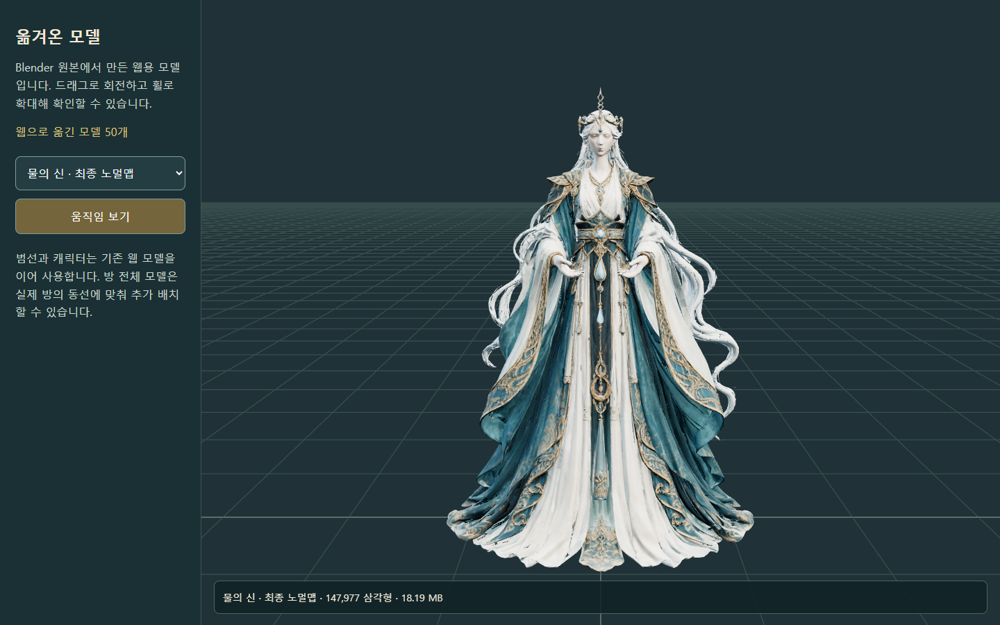
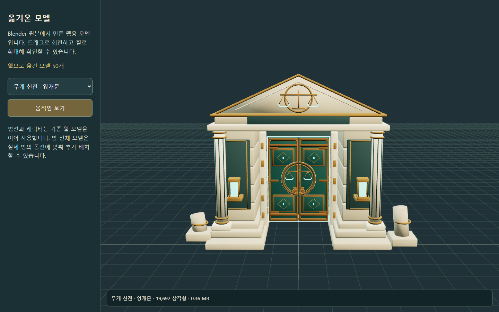
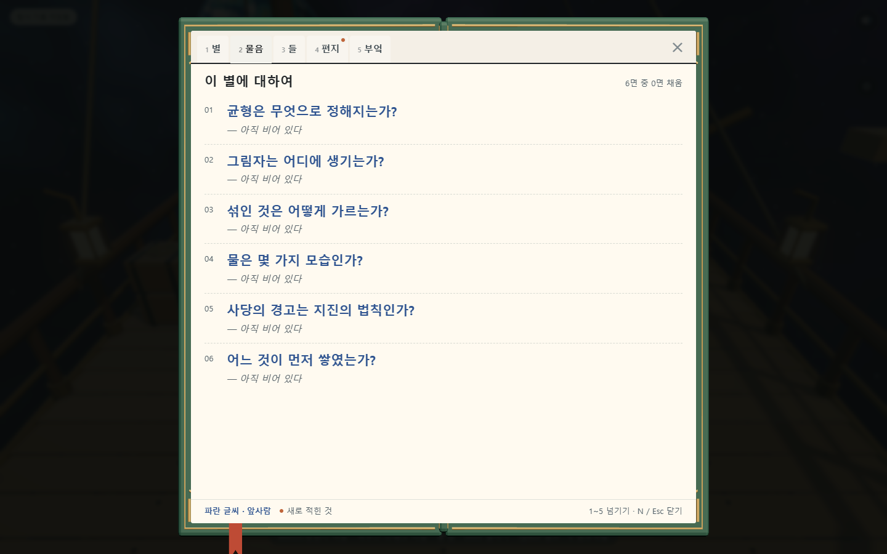

# Unity 제작 자산의 웹 이전

## 요청과 결과

사용자 요청: Unity에서 만든 중요한 자산을 옮기고, 완료 후 Unity 버전을 삭제한다.

웹용 모델 **50개 / 102.43 MiB**, 재사용 원본·참고 자료 **272개 / 942.32 MiB**를 이전했다. 원본은 복사 전후 SHA-256이 일치했다. Blender 편집 원본과 기존 웹 저장·보고서·사용자 변경은 보존했다.

Unity 프로젝트 삭제 상태: **완료 — `D:\mumumetro\unity` 삭제, 해당 경로 없음 확인**.

## 실제 게임에 연결한 것

| 자산 | 적용 |
|---|---|
| 무게 신전 외관·양개문 | 기존 사당의 시각 모델 교체, 입구 방향과 지면 기준 정렬 |
| 빙하 물 신전 외관 | 원래 물 사당과 두 번째 직접 진입 입구에 연결 |
| 균형의 신 | 지레 뒤 마지막 알현실의 이전 수호상 교체 |
| 물의 신·후광·물방울 | 기존 웹 물 신전의 마지막 성소에 연결, 최종 노멀맵 사용 |
| 탐사 수첩 | 가죽 테두리·책갈피·입체 페이지 넘김, 글은 기존 읽기 쉬운 HTML 유지 |
| 상세 풀 4종 | 플레이어 주변 최대 1,800개, 바람 변형, G·설정 토글·기기별 저장 |

수첩은 열고 넘기는 동안만 별도 렌더러를 사용하고 닫을 때 GPU 자원을 정리한다. 동작 줄이기 설정에서는 페이지 넘김을 생략한다. 풀은 낮음·가장 낮음 화질에서 자동 숨긴다. 기존 범선과 리깅된 캐릭터는 웹 자산을 이어 사용한다.

신전 건축물은 밑면이 로컬 y=0이 되도록 맞추고 행성 지면의 법선을 따른다. 원래 사당의 충돌·상호작용 반경을 유지하도록 외관 크기를 조정했다. 야외 융해 장치는 되살리지 않았으며 물 신전은 E로 바로 들어간다.

## 이전했으나 플레이 연결은 후속인 것

물 신전 세 구간의 상세 방 모델·문 장식·수집 장치·다리·성소, 층리 돌산, 정상 제단과 태양의 거울, 그림자 신전의 방·지형·장치 키트를 표준 GLB로 내보냈다. 모두 모델 검수실에서 회전·확대할 수 있다.

전체 방 배치와 Unity 전용 팔찌·등반·상태 변화 퍼즐은 기존 웹 플레이 로직에 자동 반영되지 않는다. 해당 C#·생성 도구·장면 배치·셰이더·설계 자료를 별도 참고 원본으로 보존했다. **이번 완료 범위는 자산 이전과 주요 시각 모델 연결이며, Unity 모든 기능의 웹 이식 완료를 뜻하지 않는다.**

## 보존과 제작 경로

- [보관함 안내](../../art/engine-transfer/README.md) · [원본 해시 기록](../../art/engine-transfer/preservation.json).
- [웹 모델 목록](../../assets/models/heritage/manifest.json).
- Blender 제작 도구 35개의 출력 경로를 `art/engine-transfer/model-data`로 변경했다.
- 웹 월드 내보내기 도구도 이전 보관함을 사용하며 Unity 폴더를 다시 생성하지 않는다.
- Unity의 프로젝트·실행 파일·캐시·임포트 산출물은 자산 검증 뒤 삭제했다. 원본 재질 값·텍스처·FBX와 편집 가능한 기존 Blender 파일은 남긴다.
- 사용자 웹 저장을 초기화하지 않았다. Unity의 외부 사용자 저장 파일은 삭제 대상 폴더 밖에 있다.

## 검증

| 검사 | 결과 |
|---|---|
| 원본·참고 자료 복사 전후 해시 | 272개 일치 |
| GLB 해시·실제 WebGL 로드·유효 정점·그리기 | 50개 통과 |
| 물의 신 최종 알베도·노멀맵 | 실제 GLB 재질에서 확인, 렌더 캡처 검수 |
| 외관·두 신 모델·수첩 연결 | 통과 |
| 수첩 넘김·18회 여닫기 후 메인 WebGL 유지 | 통과 |
| 풀 G 토글·저장·낮은 화질 자동 숨김 | 통과; 검증 위치의 풀 470개 / 4회 인스턴스 배치 |
| 물 신전 E 진입 | 준비한 입구 위치에서 실제 입력 경로 통과 |
| 기존 웹 통합 검사 | 27개 통과; 소포까지 보행·수첩·저장 복원·밀봉·엔딩·폰 조작 |
| 소스·로컬 import·vendor | 137개 모듈 / 351개 import / 19개 해시 통과 |
| Unity 삭제 후 보존 자료에서 GLB 재생성 | 50개 재생성 통과; Unity 폴더 재생성 없음 |
| 저장·음향 | 저장 예외·백업 검사와 음향 7개 검사 통과 |

근거: [자산 검사 결과](evidence/asset-transfer/report.json), [게임 통합 검사](evidence/web-return/quality-with-heritage.json). 검사 브라우저는 개인 저장과 분리했다. 신 모델 캡처는 준비한 장면 위치에서 촬영했으며 신전 전체를 사람이 연속 완주한 증거는 아니다.

물 입구 검사의 첫 실행은 수첩을 닫은 직후의 입력 보호 프레임 때문에 실패했다. 게임이 닫힘 프레임의 입력을 소비하는 기존 동작이었다. 검사에서 중립 프레임을 먼저 진행한 뒤 E 입력을 보내 통과했다. 해당 보호 동작을 제거하지 않았다.

## 검수 화면과 후속 개선

로컬 게임: `http://127.0.0.1:5512/`. 모델 검수실: `http://127.0.0.1:5512/tools/asset-library.html`.

큰 방 모델은 최대 15.33 MiB, 물의 신은 18.19 MiB다. 시작 시에는 외관과 수첩 약 5.64 MiB만 추가 로드하고 신 모델은 해당 신전에 진입할 때 불러온다. 학생용 기기를 위한 후속 개선은 메시 LOD·압축, 첫 진입 다운로드 표시, 실제 기기 프레임 검사다. 방 전체 모델을 연결할 때는 장치의 위치·이동 경로·바닥과 카메라 충돌을 함께 맞춘다.

GitHub 업로드·Vercel 배포는 이번 요청에 포함하지 않았으며 수행하지 않았다.
