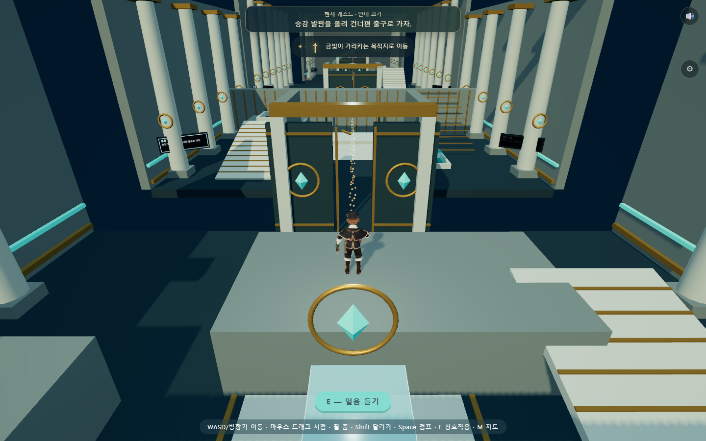
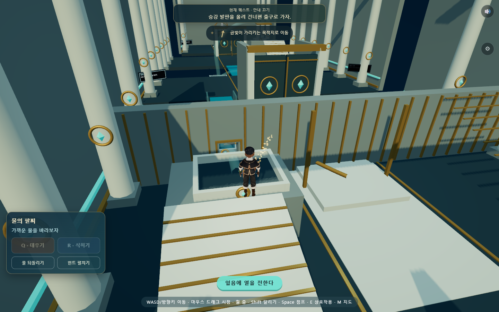
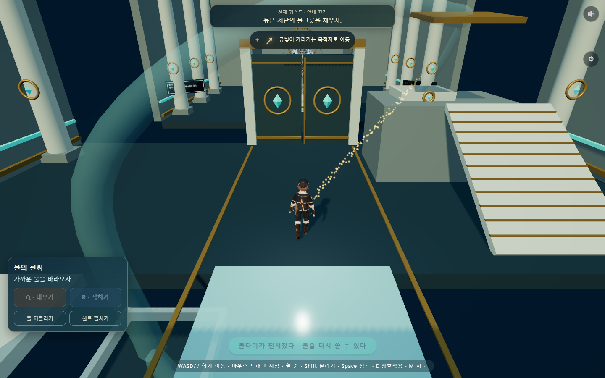
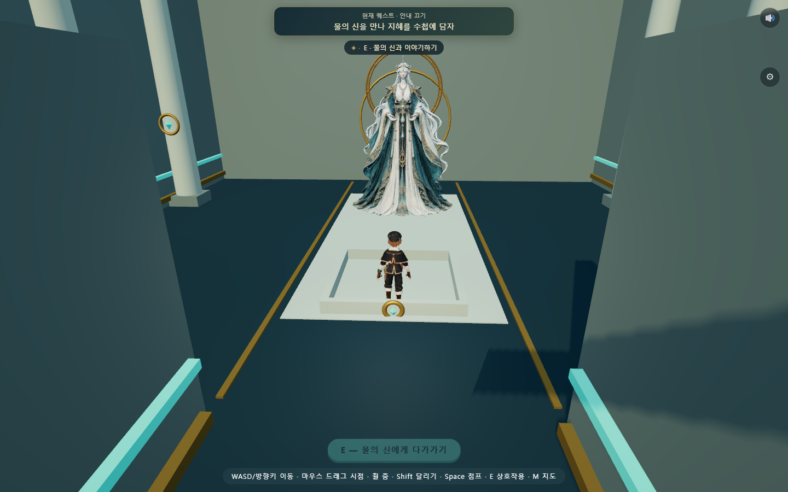

# 물 신전 개편 제작 기준

2026-10-02 사용자 요청에 따라 기존 내부 퍼즐을 교체한다. 기존 물 신전은 수조를 채우는 버튼 조합과 대기 비중이 컸다. 이번 개편은 [재설계 계획](WATER_TEMPLE_REDESIGN_PLAN.md)의 세 가지 발견을 직접 이동·운반·배치로 구현한다.

## 공간과 조작

시각 기준은 보존된 [내부 레퍼런스](../../art/glacier-water-temple/interior/v01/interior-reference.png)의 돌·황동·청록 물·밝은 틈새다. 입구·신 모델은 재사용하며 기존 내부의 집수판·가열기·냉각기 버튼은 새 플레이에 연결하지 않는다. 바닥 기준은 `y=0`, 실내 점프의 최고 높이는 약 0.9u다.

| 방 | 치수 | 배치와 실제 통과 조건 |
|---|---|---|
| 얼음 발판 | 18 × 18u | 옮기는 얼음 높이 0.78u, 목표 단 1.55u. 배치 후 점프 두 번으로 올라서면 출구와 귀환 계단이 열린다. |
| 흐르는 물 | 18 × 18u | 낮은 물을 1.55u 물길로 운반해 녹인다. 배수구를 지나 받은 물이 승강대를 올리고 건너편으로 이동한다. |
| 다시 쓰는 물 | 20 × 24u | 6.6u 수면을 얼려 건넌다. 돌다리가 열린 뒤 같은 물을 녹여 회수하고 기화·응결해 높은 제단에 모은다. |

팔찌는 첫 방에서 E로 얻는다. Q 데우기·R 식히기, E 들기/놓기, Space 점프. 모바일에는 동일한 두 능력 버튼이 있다. 물 회수·힌트는 선택 버튼으로 제공한다. 기본 제한 시간은 없다.

## 검토 기준

- 물을 얼렸다는 이유만으로 첫 문이 열리지 않는다. 실제 발판 도달을 확인한다.
- 둘째 방의 문은 물이 실제 도착하고 플레이어가 건너편에 도달해야 열린다.
- 마지막 방은 같은 물 한 덩어리를 이용한다. 변화·이동·회수·저장으로 수량이 늘지 않는다.
- 선택 보상은 첫 방의 옆 단에 두며 필수 진행에 사용하지 않는다.
- 완료 방과 이전 구슬은 보존한다. 미완료 구형 장치 상태는 해당 방의 안전한 시작 상태로 이관한다.
- 실제 입력으로 이동·운반·점프·변환·신과의 만남을 검증하고 화면을 기록한다. 재미에 대한 학생 검토는 자동 기능 검사와 구분한다.

## 적용 결과

기존 집수판·가열기·냉각기, 온도 손잡이 정답 맞추기와 대기 중심 퍼즐을 물 신전의 실행 경로에서 제거했다. `Room.js`는 물 신전에 전용 `WaterAdventure`를 조립한다. 이전 코드·보고서는 제작 이력으로 보존하며 새 플레이에서는 사용하지 않는다. 다른 다섯 신전과 야외 입장 규칙은 유지한다.

- 첫 방: 팔찌 획득 → 물을 얼려 운반 → 발판 배치 → 얼음과 높은 단으로 두 번 점프. 옆 단의 물결 조각은 선택 보상이다. 얼리거나 기다리기만 하면 문은 닫혀 있다.
- 둘째 방: 얼음을 계단 위 물길로 운반 → 녹인 물이 좁은 배수구로 이동 → 중앙 승강 발판에 탑승 → 벽 너머로 건너 실제 출구 도달. 아래에서 데우면 받이가 채워지지 않는다. 벽에는 실제 0.75u 배수구가 보이며, 3.05u 벽 높이는 위쪽 물길에서 곧장 뛰어넘지 못하도록 잡았다.
- 셋째 방: 물을 얼려 다리 만들기 → 건너면 영구 돌다리 전개 → 같은 물을 녹여 아래 그릇에 회수 → 그릇에서 기화 → 관로를 따라 위로 이동 → 높은 곳에서 식혀 제단 채우기. 처음부터 다리를 기화하면 위쪽 제단으로 보내지 못하며 다시 식히거나 회수할 수 있다.
- 마무리: 기존 고품질 물의 신 GLB와 후광을 배치했다. E로 말을 걸면 지혜를 기록하고 자동으로 신전 밖으로 돌아간다. 이미 받은 보상은 다시 주지 않는다.

변환 시간은 0.85초다. 한 입력은 한 상태만 바꾼다. 멀리 있거나 벽에 가린 물은 조작하지 못한다. 선택 대상은 금빛 테두리로 표시한다. 흐름은 관로를 따라 움직이는 빛 입자로 보여 준다. 수증기는 실제로 눈에 보이지 않으므로 신의 대사에 김과 수증기의 차이를 넣었다.

상단 퀘스트와 황금 가루는 출구 단·건너편 출구·높은 제단을 가리킨다. 물을 놓을 정답 위치를 자동 안내하지 않는다. 모바일에는 데우기·식히기·물 되돌리기·힌트 버튼을 제공하며 수첩과 방 안내를 읽는 동안 플레이가 멈춘다.

## 저장과 복구

물 신전 내부 저장은 v3, 전역 로컬 저장 키는 `mumuplanet.progress.v1`이다. v1/v2의 완료 방과 받은 구슬은 유지하며 미완료 장치는 새 방의 시작 상태로 이관한다. 구형 물 신전 기록 전체는 새 저장 안의 `legacyWater`에 보관한다. 실제 사용자 저장을 검사에 사용하거나 초기화하지 않았다.

운반 중 저장한 얼음은 해당 방의 안전한 회수 위치에 놓인 상태로 복원한다. 이동 연출 중에는 도착 지점을, 변환 중에는 변환 전 상태를 저장한다. 다시 접속하면 첫 미완료 방의 안전한 바닥에서 시작한다. 물 수량은 방마다 하나이며 회수 시 복제되지 않는다. 여기서 수량 `1`은 게임 안의 보존 단위이며 리터·질량·부피를 계산하는 유체 시뮬레이션은 아니다.

## 검증 결과

| 검사 | 결과·근거 |
|---|---|
| 세 방 연속 이동·운반·점프·승강·변환·신과의 만남 | [21개 통과](evidence/water-adventure/report.json). 입장만 준비하고 이후 좌표 순간이동 없이 실제 이동 입력으로 완주. 카메라는 검사 도구가 자동 조향한다. |
| 옛 저장·재접속·키보드·모바일·정지·복구 | [19개 통과](evidence/water-adventure/safety-report.json). v1/v2의 완료 0~3방과 보상 조합 10가지, 잘못된 저장 8종의 원자적 거부, 운반 중 실제 새로고침 확인. |
| 화면 크기 | 390×844, 844×390, 1024×768에서 팔찌 패널이 화면 안에 있고 퀘스트·점프 버튼과 겹치지 않음. 능력 버튼 높이 40px 이상. |
| 검사가 실제 고장을 잡는가 | 첫 목표 단의 충돌 높이를 일부러 0.7u 높인 검사에서 보행이 막혀 [예상대로 실패](evidence/water-adventure/failure-injection.json). 정상 게임 파일은 바꾸지 않았다. |
| 기존 웹 기능 | 기존 브라우저 통합 [27개 통과](evidence/water-adventure/regression.json). 시작·소포·수첩·음향·저장·다른 신전 이어하기·엔딩 확인. |
| 기본 검사 | 141개 소스 모듈·358개 import·19개 vendor 해시, 로컬 저장·백업, 음향 7항목 통과. |

검사 중 둘째 방의 원래 물 위치가 경사로 아래에 겹쳐 접근이 막혔다. 물을 반대쪽 열린 바닥으로 옮겼다. 셋째 방의 경사로와 높은 단도 0.55u 턱 때문에 보행이 막혔으며 경사로 끝을 단의 가장자리와 일치시켰다. 정상 경로뿐 아니라 벽 너머 변환 차단과 다리를 녹인 뒤 돌다리 왕복도 확인했다.

## 실제 화면과 설계도

[새 평면 설계도](../../art/water-adventure-web/blueprint.svg)는 공간의 역할을 설명하는 도식이다. 아래는 구현된 게임 화면이며 목표 레퍼런스 이미지가 아니다.

## 비판적 검토와 다음 개선

공식 레퍼런스 조사에서 가져온 핵심은 새 버튼 종류를 늘리기보다 같은 능력을 다른 공간 문제에 재사용하는 것이다. 이번 구현은 상태 맞추기에서 운반·높이·이동 경로·물 재사용으로 판단 대상을 옮겼다. 기다리는 대신 직접 움직여 결과를 만드는 구조가 됐다. 자동 완주 성공은 학생이 재미있게 느낀다는 근거가 아니다.

내부는 새 동선에 맞춘 웹 메시로 구성했다. 보존된 레퍼런스의 석재 표면, 아치, 배관 지지대, 장식 밀도까지 재현한 상태는 아니다. 추가 Blender 마감은 이번 동선과 충돌 높이를 유지하며 진행해야 한다. 물의 흐름도 정해진 경로를 이용하는 게임 연출이고 자유 유체 계산은 아니다. 실기기 프레임과 학습 효과는 아직 측정하지 않았다.

다음은 개발자가 해법을 설명하지 않은 학생 5명 정도의 첫 플레이를 보는 것이다. 첫 조작까지 걸린 시간, 물을 왜 얼리거나 녹였는지 설명하는지, 막힌 원인, 힌트 사용, 선택 보상 시도와 재도전 의향을 기록한다. 특히 둘째 방에서 물길과 승강대의 연결, 셋째 방에서 기화·응결의 이동을 읽는지 확인한다. 여기서 막히면 문장이나 장식을 늘리기 전에 배치와 결과 표시부터 조정한다.
