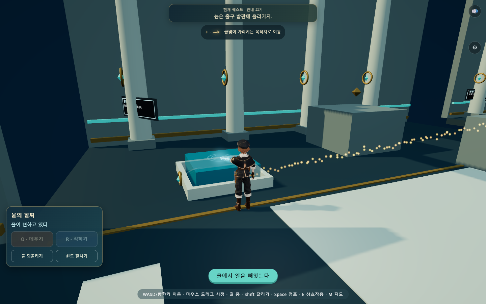
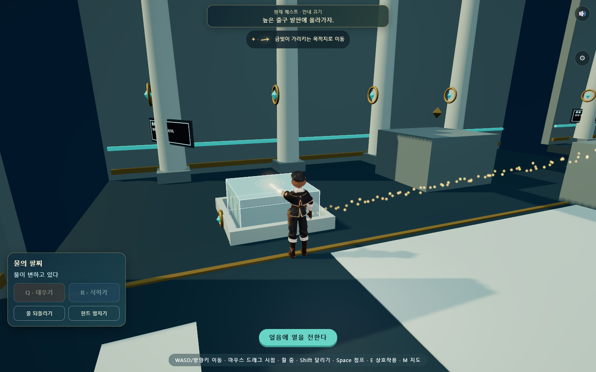
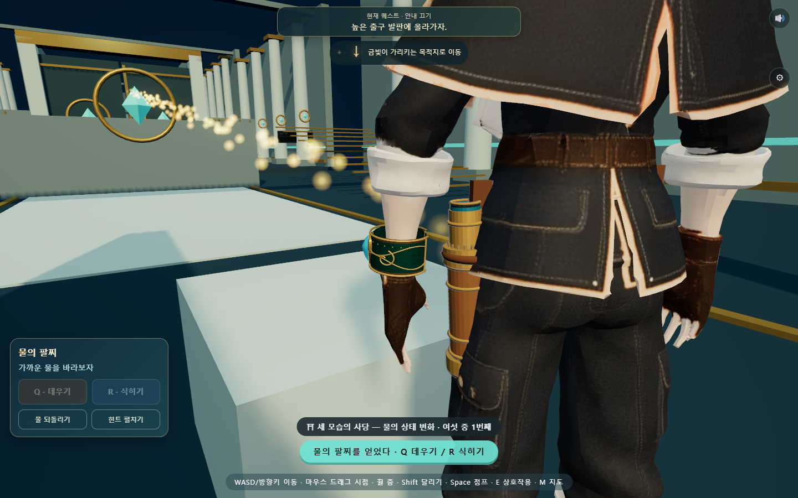
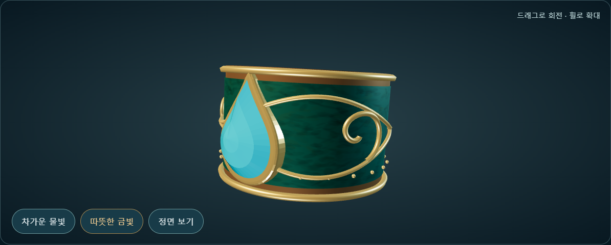

# 물의 팔찌와 광선 개선

2026-10-03 · 웹 Three.js 로컬 적용. 실제 사용자 저장은 사용하지 않았다.

## 적용 결과

기존 웹판에는 진열대의 단순 금속 고리만 있고, 착용 팔찌와 물로 이어지는 광선은 없었다. 기존 물방울 시안에 맞춘 커프를 진열대와 실제 왼손 손목에 연결했다. 광선은 보석 바깥에서 시작해 선택한 물의 보이는 표면에 닿는다.

- 청동·금 테두리, 청록색 표면 질감, 물결·소용돌이 조각, 작은 장식과 입체 보석.
- 가열은 따뜻한 금빛과 손목 → 물 방향의 잔입자. 냉각은 푸른빛과 물 → 손목 방향의 잔입자.
- 약 0.20초의 점등 곡선과 지수 보간, 0.67초부터 감쇠해 1.12초에 소등. 물을 놓쳐도 부드럽게 꺼진다. 장애물·오버레이·회수·퇴장에서는 숨긴다.
- 손목의 짧은 시전 동작과 원래 걷기 동작으로의 복귀. 수첩·얼음 운반·점프가 우선한다.
- 옅은 겨냥 원과 물 표면 파문. 광선과 잔입자의 가장자리는 부드럽게 흐려진다.
- 낮은 화질은 입자 12개, 기본은 32개. 동작 줄이기 설정은 입자를 숨기고 광선 흔들림을 없앤다.

Q/R 조작, 기존 0.85초 상태 변화 판정, 퍼즐 해법과 v3 저장 구조를 유지했다. 시전 표시용 카운터·메시·효과는 저장 데이터에 들어가지 않는다.

## 실제 화면

[회전·확대 검수 화면](../../art/water-bracelet-web/preview.html) · [기준 시안](../../art/glacier-water-temple/interior/v01/bracelet-reference.png) · [상세 제작 기준](../../art/water-bracelet-web/DESIGN.md)

## 검토하며 고친 부분

첫 모델의 문양과 평면 보석이 너무 단순해 소용돌이 양각·질감·입체 면을 추가했다. 확대 착용 화면에서는 팔찌가 너무 크게 떠 보여 배율을 0.58로 줄였다. 실제 손목 정점의 95% 반지름과 안감 사이에 약 1.7mm 여유가 남는다. 처음에 찍은 위에서 내려다보는 화면은 광선을 판단하기 어려워 실제 측면 플레이 시점으로 바꿔 캡처했다.

이동하며 물을 놓칠 때의 소등 검사에서 급한 밝기 변화가 발견됐다. 목표 광량에도 지수 보간을 적용해 회전 시 감쇠를 수정하고 다시 검사했다. 냉각 입자의 방향도 열을 빼앗는 표현에 맞춰 반대로 흐르게 했으며, 양 끝에서 입자가 갑자기 이동해 보이지 않도록 소멸 곡선을 넣었다.

장식 29개를 5개 메시로 합쳤다. 모델 9,828삼각형, 착용 반지름 0.0377m·폭 0.0499m. 원본은 `art/water-bracelet-web/water-bracelet-v01.blend`에 보존했고 검수용 GLB도 생성했다. Blender 원본은 실제 웹 기하·재질·UV를 편집할 수 있도록 보존한 것이며, 웹 게임에서는 절차적 메시와 셰이더를 실행한다.

## 검증과 범위

| 검사 | 결과 |
|---|---|
| 새 팔찌 브라우저 검사 | 23개 통과: 실제 획득·이동·회전, 밀착·크기·피부 여유, 광선 연결·밝기·색·팔 복귀, 저장 불변, 저화질·동작 줄이기·회수·오버레이·퇴장 |
| 물 신전 실제 이동 완주 | 21개: 얼음 발판 → 물길·승강대 → 다리·기화·응결 → 신·자동 퇴장 |
| 손목 고장 주입 | 검사 브라우저에서 팔찌를 떼고 0.5m 이동했을 때 밀착 검사가 예상대로 실패 |
| 기본 검사 | 소스 142개·로컬 import 363개·vendor 해시 19개, 저장·음향 통과 |
| 모델 | 실제 WebGL 확대 렌더 오류 없음, Blender 저장·GLB 생성 성공 |

근거: [23개 검사](evidence/water-bracelet/report.json), [고장 주입](evidence/water-bracelet/failure-injection.json), [모델 측정](evidence/water-bracelet/model-metrics.json), [신전 완주](../2026-10-02/evidence/water-adventure/report.json).

검사는 격리된 Edge와 자동 입력을 사용했다. 모바일 캡처는 화면 크기 확인이며, 학생용 태블릿의 GPU 성능·장시간 플레이·학생 반응을 확인한 것은 아니다. 기존 시안의 사실적인 금속 마모, 환경 반사와 보석 내부 굴절까지 같은 수준은 아니다. 현재의 작은 손목 소품에는 실루엣과 자연스러운 연결을 우선했고, 고해상도 마모·반사 맵은 기기 성능을 확인한 뒤 추가할 수 있다.
