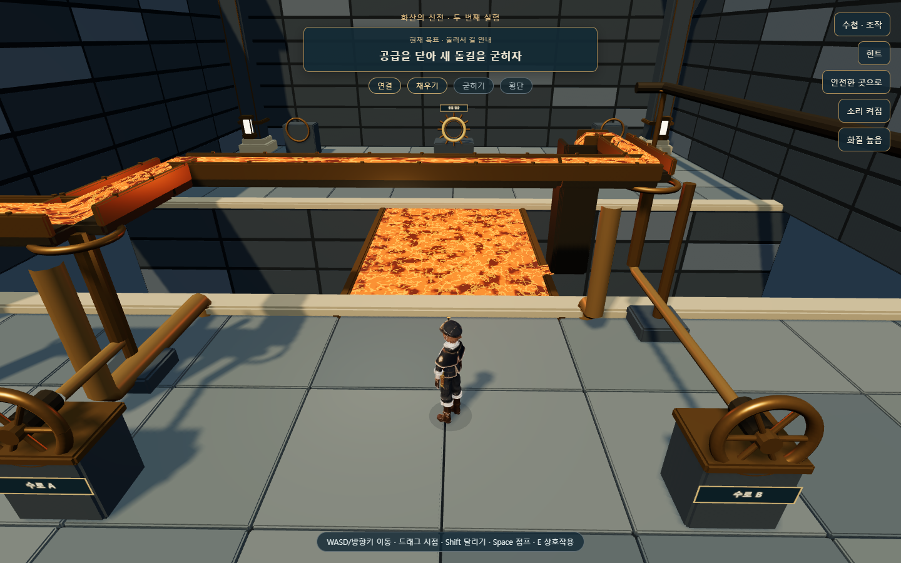
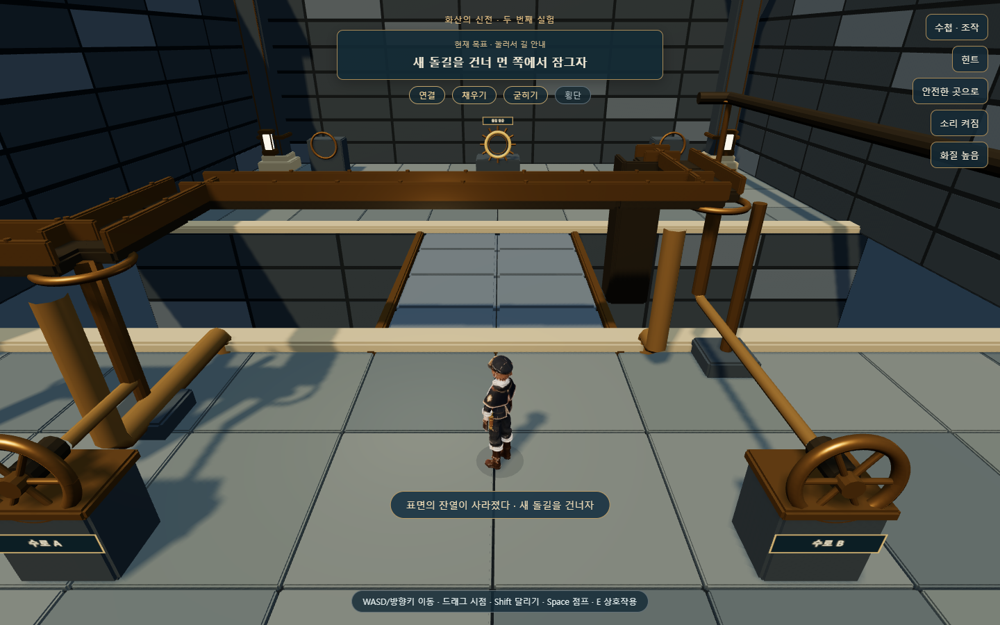
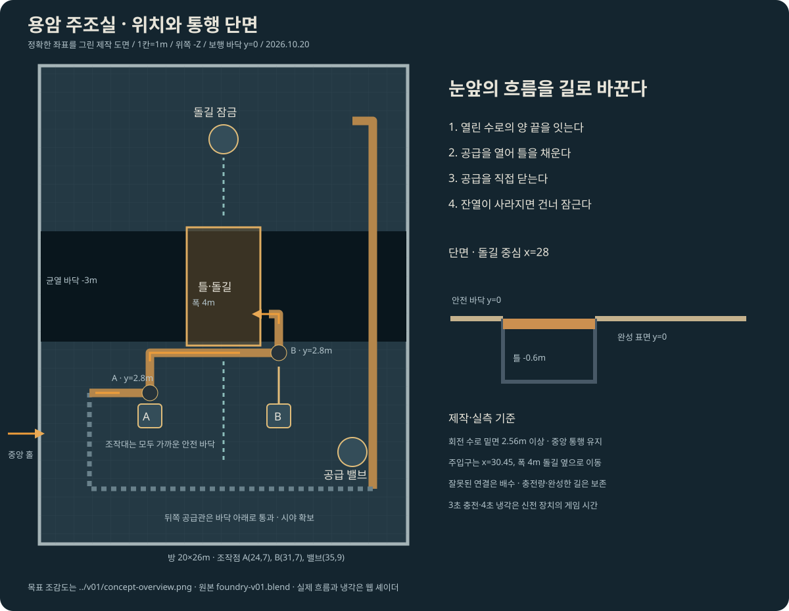

# 화산 신전 · 용암 주조실 연결

2026-10-20 / 웹 Three.js 0.160.0 / 로컬 시제품

후속 변경 · 2026-10-21: 증기 승강실·상층 통로와 세 방 저장 v2를 연결했다. 현재 저장·이관·적용 범위는 [최신 증기실 보고서](../2026-10-21/FIRE_STEAM_BUILD.md)를 따른다. 아래는 두 방 제작 당시의 기록이다.

## 결과

첫 균열 회랑에 **용암 주조실을 연결했다.** 입구에서 두 방을 실제로 걸어 연속 진행한다. 회랑을 마치고 중앙 홀로 돌아오면 오른쪽 문이 올라간다. [두 구간 플레이](http://127.0.0.1:5512/fire-trial.html) · [제작 도면과 세부 기준](../../art/fire-temple/foundry-v01/DESIGN.md).

수로 두 곳 연결 → 공급 열기 → 틀 채우기 → 공급 닫기 → 표면 굳히기 → 새 돌길 횡단·잠금 → 중앙 홀 복귀가 동작한다. 기존 본편의 불 신전 교체와 증기 승강실은 이번 범위에 포함하지 않는다.

## 게임 규칙

| 플레이 | 결과 |
|---|---|
| 입구 쪽 A/B 손잡이로 수로 회전 | 높은 ㄱ자 수로가 실제로 90도씩 돌아가 포트가 고정 관과 만남 |
| 연결되지 않은 상태에서 공급 | 연결된 부분까지만 흐르며 잘못된 흐름은 닫힌 배수관으로 복귀. 틀은 차지 않음 |
| 공급 중 수로 회전 시도 | 공급을 먼저 닫으라는 피드백. 수로가 순간 이동하지 않음 |
| 두 곳을 연결하고 공급 | 용암 표면이 틀 바닥에서 올라옴. 초과 충전되지 않음 |
| 일부만 채운 뒤 공급 차단 | 채운 양 보존. 다시 공급해 이어 채울 수 있음 |
| 가득 찼지만 공급을 열어 둠 | 계속 뜨거우며 기다리기만 해서는 돌길이 되지 않음 |
| 가득 찬 뒤 공급 차단 | 가장자리부터 어두운 껍질이 퍼지고 잔열이 사라진 뒤 실제 보행면 생성 |
| 굳기 전 공급 재개 | 냉각 중단·잔열 복귀. 완성된 돌길은 다시 녹이지 않음 |
| 뜨거운 틀·균열에 진입 | 가까운 바닥으로 복귀. 방향·충전량·완성한 길은 유지하고 공급은 닫음 |
| 직접 횡단 후 먼 쪽 잠금·홀 복귀 | 두 번째 실험 완료. 다음 목표는 증기 승강실 |

충전 3초·냉각 4초는 허구의 신전 장치에 사용하는 게임 시간이다. 수첩을 열면 이동과 충전·냉각이 멈춘다. PC와 터치가 같은 E 상호작용 경로를 사용한다.

## Blender와 화면 마감

기존 [전체 목표 이미지](../../art/fire-temple/v01/concept-overview.png)의 청동 수로·검은 석재·주황 흐름을 기준으로 만들었다. 원래 전체 `.blend`와 회랑 자산은 보존했다.

- 새 편집 원본: [foundry-v01.blend](../../art/fire-temple/foundry-v01/foundry-v01.blend).
- 새 내보내기: [build_fire_foundry_v01.py](../../tools/blender/build_fire_foundry_v01.py). [실행 기록](fire-foundry-export.log).
- 배포 자산: 고정 건축·회전 수로·조작대·바퀴·돌길·문 GLB 6개와 실측 manifest. 약 1.9MB 추가.
- 기존 주조실의 정적 용암·고정 수로·미리 깔린 다리를 실행 모델에서 제외했다. 흐름·충전·냉각은 웹 셰이더이고 돌길은 별도 Blender 모델이다.
- 손잡이와 수로는 보이는 축으로 연결했다. 실제 벽·기둥·새 지지대·옆 주입구의 측정값을 충돌에 사용한다.
- 돌길 표면 실측 y=0, 회전 수로 밑면 약 2.56m. 원형 홀·첫 회랑과 같은 바닥 기준이다.
- 뒤쪽 횡단 공급관이 화면을 가리는 것을 실제 캡처에서 발견해 바닥 아래로 돌렸다. 주조실 카메라는 장치를 내려다볼 수 있게 시선 높이를 조정했다.
- 처음의 중앙 주입구는 시야를 가리고 보이는 통행 공간을 침범했다. x=30.45의 길 옆으로 옮기고 최소 x>30 실측 검사를 추가했다. 기능 완주만으로 외형·충돌의 일치를 보장할 수 없다는 사례다.
- 용암의 큰 반복 무늬를 줄이고 세밀한 불규칙 껍질·밝은 틈·느린 흐름으로 바꿨다. 동작 줄이기에서는 시간 변화를 멈추고 낮은 화질에서는 추가 광원과 그림자를 줄인다.

목표 이미지의 풍화된 석재·균열·미세 재질과 같은 수준의 최종 마감은 아니다. 현재는 동일 테마의 건축·장치와 두 방의 플레이를 연결한 시제품이다. 실제 학생 기기의 FPS는 아직 측정하지 않았다.

## 저장

새 키는 **`mumuplanet.fire-trial.v1`**이다. 두 방 상태와 안전 체크포인트를 하나의 JSON으로 검증한 뒤 한 번에 저장한다. 처음부터 다시 시작하기 전에는 `mumuplanet.fire-trial.previous.v1`에 보관한다.

기존 **`mumuplanet.fire-fracture.v1`**을 읽어 회랑 진행을 이어받고 원문은 수정하지 않는다. 기존 완료 기록이면 중앙 홀에서 오른쪽 주조실로 이어갈 수 있다. 본편 **`mumuplanet.progress.v1`**은 시제품에서 읽거나 쓰지 않는다.

- 운반 중 받침은 마지막 안전 바닥 위치로, 주조실은 현재 충전량과 굳힌 길을 유지해 복원한다.
- 다시 시작할 때 공급은 닫는다. 실행 중인 장치가 사용자 없는 사이에 자동으로 퍼즐을 진행하지 않는다.
- 새로고침 시 위험한 틀 위가 아닌 가까운/먼 안전 발판 또는 중앙 홀에서 시작한다.
- 중복 받침, 잘못된 방향·충전량·냉각 값, 첫 방을 마치지 않고 둘째 방만 진행한 모순을 거부한다. 일부 상태를 먼저 적용하지 않는다.
- 저장 용량·보관 실패 때 기존 원문을 지우거나 덮어쓰지 않는다.

## 검증 결과

검사 도구는 해법을 알고 실제 `Input`과 `RoomActor`로 이동한다. 정상 완주를 순간 이동이나 완료 상태 주입으로 대신하지 않았다. 모바일은 터치 가능한 브라우저 에뮬레이션이며 실기기·학생 재미 검토와 구분한다.

| 검사 | 결과 |
|---|---|
| 새 [주조실 검사](../../tools/check-fire-foundry.cjs) | **33개 통과**, [report.json](evidence/fire-foundry/report.json) |
| 기존 [회랑 검사](../../tools/check-fire-fracture.cjs) | **33개 통과**, [report.json](evidence/fire-fracture/report.json) |
| 연속 완주 | 입구→회랑 고정·시험·횡단·잠금→홀→주조실 충전·냉각·횡단·잠금→홀 |
| 실패·재도전 | 오연결, 한 곳만 연결, 부분 충전, 열린 공급, 뜨거운 틀, 냉각 중 재가열 |
| 저장 | 부분 충전 후 실제 새로고침, 완료 복원, 기존 회랑 이관·원문 유지, 전체 검증·보관/용량 실패 |
| 카메라·화면 | 주조실 36개 방향/각도에서 벽 내부 진입 없음. 390×844·844×390·1024×768 표시 |
| 터치·안내 | 실제 문맥 버튼으로 공급 열기·닫기. 옆 밸브에서 시작해도 황금 가루가 실제 다리로 안내 |
| 고장 주입 | 굳은 길의 충돌면을 -3m로 바꾸자 실제 횡단 중 추락을 검출, 예상 종료 코드 1 |
| 기본 검사 | 소스 149개·로컬 import 389개·vendor 해시 19개, 기본 저장, 음향 7개 통과 |

[고장 검출 근거](evidence/fire-foundry/failure-injection.json)는 테스트 브라우저 메모리에서만 잘못된 충돌면을 넣은 결과다. 정상 코드·사용자 기록은 바꾸지 않았다.

초기 저장 검사 중 한 항목은 기본값 false를 다시 false로 바꾼 뒤 거부를 기대한 잘못된 검사였다. ‘첫 방 미완료인데 둘째 방 방문’이라는 실제 모순으로 고친 뒤 검증했다. 런타임 오류였다고 보고하지 않는다.

## 다음

증기 분기로 접근 다리를 내리고 영구 잠근 뒤, 동력을 승강기로 바꿔 직접 탑승·상승하는 구간이다. 이후 수호자 이벤트와 기존 본편 기록 이관을 검증해 본편 교체를 진행한다.

이번 작업은 로컬 구현이며 GitHub 업로드·Vercel 배포는 실행하지 않았다.
