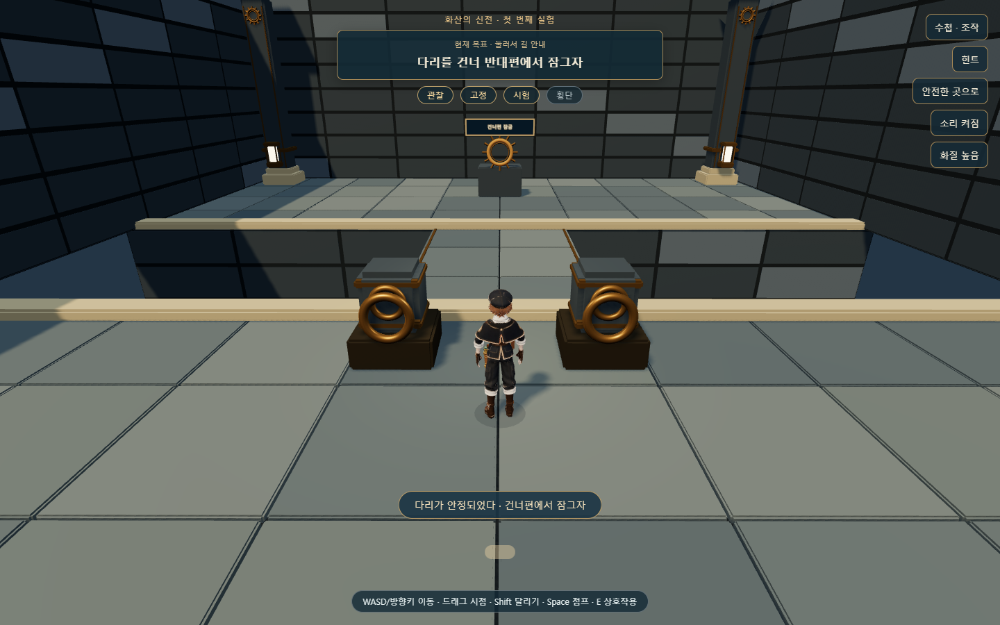
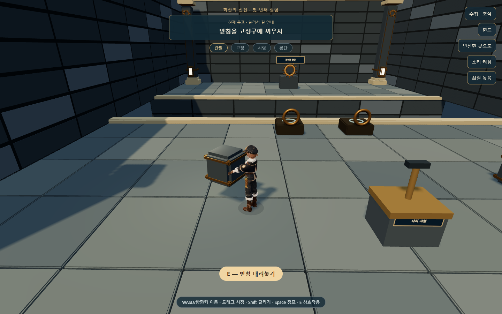
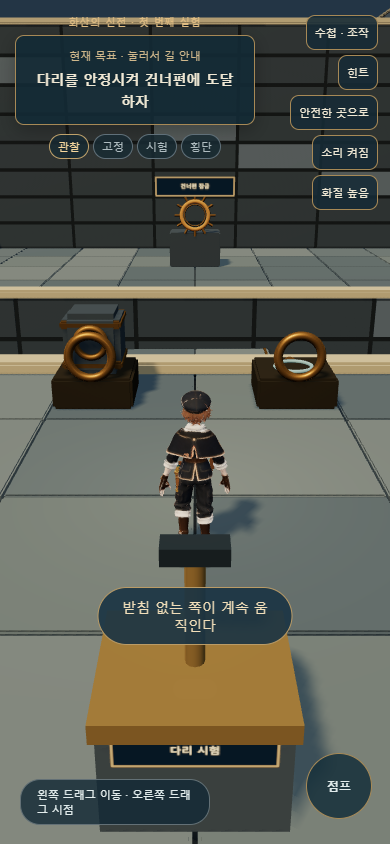

# 화산 신전 · 첫 균열 회랑 플레이 시제품

2026-10-20 / 웹 Three.js 0.160.0 / 로컬 구현·검증

후속 변경: 주조실과 연결하면서 저장을 두 방 묶음으로 확장했다. 현재 실행·저장·이관 기준은 [주조실 구현 보고서](FIRE_FOUNDRY_BUILD.md)를 따른다. 아래 저장 키와 적용 범위는 최초 회랑 제작 단계의 기록이다.

## 결과

설계와 Blender 지도에서 **입구 → 중앙 홀 → 균열 회랑**을 분리해 실제로 걸으며 실험하는 구간을 연결했다. 기존 본편 불 신전은 그대로 두고 [별도 플레이 페이지](http://127.0.0.1:5512/fire-trial.html)에서 검토한다. [시안·설계·원본 모델](../../art/fire-temple/v01/review.html)에도 플레이 버튼을 추가했다.

**받침 운반 → 양쪽 고정 → 시험 → 다리 횡단 → 건너편 잠금 → 중앙 홀 복귀**까지 구현했다. 두 받침을 꽂는 것만으로 완료하지 않는다. 한쪽 고정 상태에서는 시험이 실패하고, 이미 꽂은 받침은 유지한다.

## 플레이와 조작

| 단계 | 실제 동작 |
|---|---|
| 입구·중앙 홀 | 같은 Blender 건축 모델 위를 걸어 왼쪽 회랑으로 이동 |
| 관찰 | 시험 손잡이를 당기면 낮게 기운 다리가 흔들림. 한쪽을 고정하면 그쪽을 기준으로 움직임 |
| 받침 | E로 실제 소품을 들고 운반·내려놓기·고정구에 끼우기. 캐릭터 운반 자세 연결 |
| 시험 | 양쪽을 고정하고 시험을 마쳐야 다리가 바닥 높이까지 올라와 안정됨 |
| 횡단·잠금 | 실제 충돌면을 걸어 건넌 뒤 먼 쪽 손잡이를 E로 조작 |
| 복귀 | 잠긴 다리로 다시 건너 중앙 홀에 도달하면 첫 실험 완료 표시 |
| 재도전 | 추락·안전한 곳으로 이동 시 가까운 안전 발판으로 복귀. 끼운 받침과 고정된 다리는 유지 |

PC는 WASD/방향키, 드래그 시점, Shift 달리기, Space 점프, E 상호작용이다. 터치는 왼쪽 드래그 이동·오른쪽 드래그 시점과 점프·문맥 버튼을 사용한다. 수첩을 열면 움직임과 시험 시간이 멈춘다.

상단 목표를 누르면 선택 가능한 황금 가루가 이동 경로를 보여 준다. 힌트는 요청할 때 세 단계로 제공한다. 소리·화질 설정과 조작 수첩도 연결했다.

## Blender 자산과 실제 보행

- 원본 `art/fire-temple/v01/fire-temple-v01.blend`를 읽되 변경하지 않고, 배포 자산은 `assets/models/fire-temple/`로 분리했다.
- 고정 건축, 다리, 받침, 고정구, 잠금 장치의 GLB 5개와 배치·충돌 실측 manifest를 생성했다. 합계 약 3.6MB이며 건축은 재질별로 합쳤다.
- 다리와 받침은 자체 원점을 가진 별도 모델이다. 다리의 보이는 높이·기울기와 보행 충돌면이 같은 상태를 사용한다.
- 기둥·문틀·벽의 실제 경계로 보행 및 카메라 충돌을 구성했다. 닫힌 입구 문짝과 문에 붙었던 장식은 시제품의 열린 입구에서 제외했다.
- 입구 직선 바닥과 원형 홀 바닥이 접선으로만 만나는 오류를 실제 이동 검사로 발견했다. Blender에 겹침 바닥을 추가하고 높이 0.04m의 동일 실측을 보행에도 적용했다.
- 천장이 없는 시제품 공간의 카메라 후퇴 범위를 넓히고 실제 벽 충돌은 유지했다. 시험대의 큰 공중 표지판을 작은 전면 명판으로 바꿔 다리가 가려지지 않게 했다.

재생성 도구는 [Blender 내보내기](../../tools/blender/export_fire_fracture_v01.py)이며 실행 기록은 [export 로그](fire-fracture-export.log)다. 게임에서 추가한 시험 손잡이·연결 지지대·안내 글은 런타임 메시다. 모든 소품을 Blender로 새로 조각했다고 보고하지 않는다.

## 저장과 기존 기록 보존

| 기록 | 키·처리 |
|---|---|
| 본편 | `mumuplanet.progress.v1` — 시제품은 이 키를 읽거나 쓰지 않음 |
| 시제품 | `mumuplanet.fire-fracture.v1` — 고정구·받침 위치·다리·잠금·안전 체크포인트 |
| 처음부터 시작 전 보관 | `mumuplanet.fire-fracture.previous.v1` |

운반 중 저장하면 들고 있던 받침은 마지막으로 검증한 바닥 위치에 복원한다. 고정한 받침은 유지하며 공중·균열 위에서 시작하지 않는다. 중복 슬롯, 잘못된 좌표·버전, 완료 조건이 모순된 기록은 전체 적용 전에 거부한다. 읽을 수 없는 원본은 보관 후 새로 시작하고, 보관에 실패하면 원본을 덮어쓰지 않는 임시 플레이로 진행한다. 용량 초과는 기존 데이터를 지우지 않고 화면에 알린다.

## 검증

[자동 검사 도구](../../tools/check-fire-fracture.cjs)는 격리된 Edge와 실제 `Input`·`RoomActor` 이동을 사용했다. 장치나 완료 위치로 순간 이동해서 정상 완주를 대체하지 않았다. 검사 도구는 해법을 알고 조향한다.

| 검사 | 결과 |
|---|---|
| 시제품 흐름·실패·재도전·저장·터치·화면·카메라 | **33개 통과**, [report.json](evidence/fire-fracture/report.json) |
| 카메라 | 시험대 36개 방향/각도에서 측정 고체 내부 진입 0회, 다리 방향 후퇴 거리 4.5m 이상 |
| 저장 | 운반 중 및 완료 후 실제 새로고침 복원, 잘못된 데이터·보관 실패·용량 초과 처리 |
| 화면·터치 | 390×844, 844×390, 1024×768 HUD, 터치 E·점프·이동·수첩 |
| 본편 기록 | PC·터치 브라우저의 별도 표식 기록이 그대로 유지됨 |
| 고장 주입 | 다리 충돌 높이를 -3m로 잘못 바꾸자 실제 횡단에서 추락 검출, 예상 종료 코드 1 |
| 기본 소스 | 145개 모듈·376개 로컬 import·19개 vendor 해시 통과 |
| 기본 저장·음향 | 저장 왕복·백업·잘못된 값·저장 불가, 음향 7개 검사 통과 |

고장 주입은 테스트 브라우저 메모리에만 적용했다. [실패 근거](evidence/fire-fracture/failure-injection.json)가 남으며 저장소의 정상 충돌 코드는 변경하지 않았다.

자동 검증과 학생 플레이 검토는 다르다. 학생이 힌트 없이 구조를 이해하는지, 받침 배치가 너무 자명한지, 왕복이 즐거운지와 실제 휴대폰 성능은 아직 확인하지 않았다. 생성한 목표 시안의 조각·재질·마모 디테일까지 완성된 상태도 아니다.

## 다음 작업

다음은 **용암 주조실: 흐름 연결 → 틀 채우기 → 공급 차단 → 굳히기 → 새 돌길 횡단**이다. 이어 증기 승강실·수호자 이벤트를 연결하고 전체 흐름과 기존 불 신전 기록 이관을 검증한 뒤 본편 교체를 진행한다.

이번 결과는 로컬 시제품이다. GitHub 업로드나 Vercel 배포는 실행하지 않았다. `art/` 검수 페이지는 기존 배포 제외 규칙을 유지한다.
