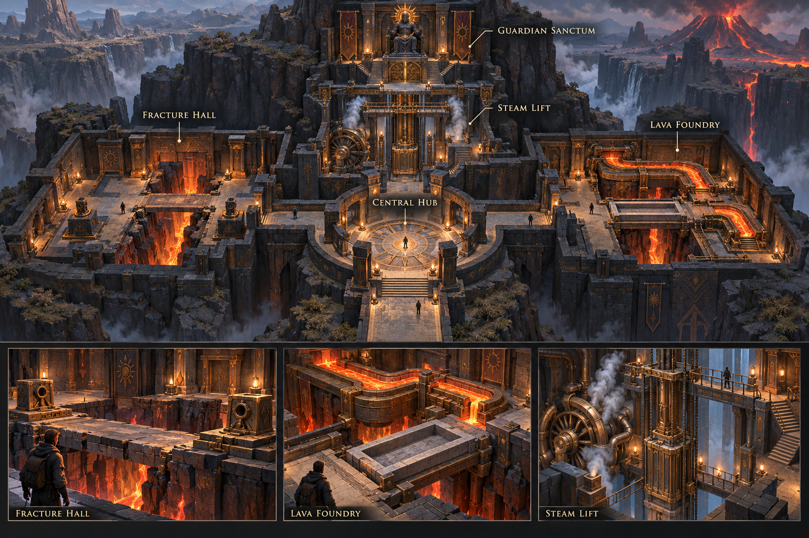
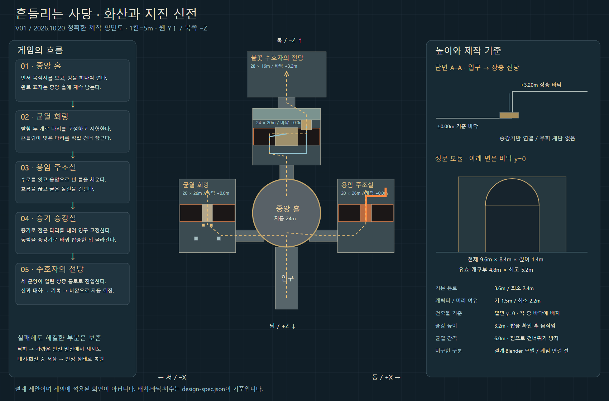
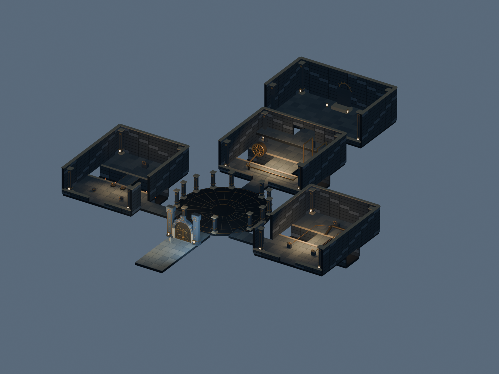
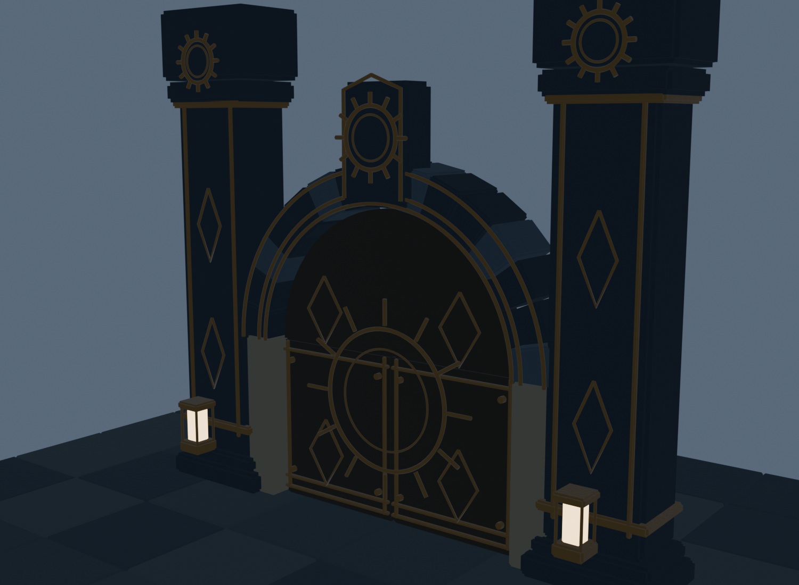

# 화산·지진 신전 · 설계와 Blender 제작 시작

2026-10-20 / 실제 웹 게임의 다음 신전 개편 준비

후속 구현: 설계 이후 첫 균열 회랑을 별도 플레이 시제품으로 연결했다. 현재 적용 범위와 검증은 [균열 회랑 구현 보고서](FIRE_FRACTURE_BUILD.md)를 따른다. 아래 내용은 최초 설계·건축 단계의 기록이다.

## 이번에 만든 것

사용자의 요청에 따라 **설계 이미지를 먼저 제작하고, 그에 맞춘 Blender 건축 모델을 시작했다.** 기존 게임의 불 신전 로직을 교체한 것은 아니다.

1. 중앙 홀과 세 구역·수호자 전당이 함께 보이는 콘셉트 조감도.
2. 정문의 정면·사선, 석재·청동과 장치의 제작 시안.
3. 정확한 평면·단면·치수와 퍼즐 흐름을 묶은 SVG/PNG 설계도.
4. 목표·상태·완료 조건·실패 복구·저장·검증 순서를 적은 상세 설계서.
5. 같은 좌표 데이터로 만든 Blender 지도·정문·다리·수로·증기 동력 장치의 1차 모델, GLB와 실제 렌더.
6. 생성 이미지와 실제 모델을 구분해 보는 로컬 검수 페이지. 모델 회전·확대, PC·좁은 화면 확인.

모든 원본은 [제작 폴더](../../art/fire-temple/v01/)에 보존했다. [검수 화면](../../art/fire-temple/v01/review.html) · [상세 설계](../../art/fire-temple/v01/DESIGN.md) · [정확한 도면](../../art/fire-temple/v01/blueprint.svg).

## 바뀌는 게임의 중심

| 구역 | 하는 일 | 완료 조건 |
|---|---|---|
| 균열 회랑 | 흔들리는 부위를 보고 받침으로 다리 고정 | 받침 둘 + 시험 성공 + 실제 건너편 잠금 |
| 용암 주조실 | 용암을 틀에 모아 새 돌길 생성 | 수로 연결 + 틀 충전 + 공급 차단 + 냉각 + 횡단 |
| 증기 승강실 | 분기로 동력을 나눠 다리와 승강기 작동 | 다리 영구 잠금 + 동력 전환 + 탑승 + 상층 도착 |
| 수호자 전당 | 세 구역에서 바꾼 공간의 결과를 확인 | 신과 대화 + 1회 기록·구슬 지급 + 안전 퇴장 |

필수 해법을 숫자·버튼 순서로 외우게 하지 않고, 보이는 구조를 바꿔 전진하도록 설계했다. 구역별 재미와 이해도는 아직 학생 플레이로 확인하지 않았다.

## 이미지와 실제 구현을 구분

위는 미술 목표다. 아래는 실제 좌표와 제작 기하를 검수하는 도면·모델이며, 같은 품질에 도달했다고 주장하지 않는다.

수호자 전당에는 현재 왕좌·후광과 배치 공간만 있다. 콘셉트 속 인물은 앞으로 조각할 대상이다. 생성 이미지에 보이는 주변 절벽·화산 배경도 이번 모델에 제작한 상태가 아니다.

## 검토 중 발견하고 수정한 것

- 최초 승강실 배치의 평평한 바닥으로 다리를 우회할 수 있어, 실제 6m 틈과 별도 다리로 변경했다.
- 상층 출구와 북쪽 벽이 겹치는 부분을 발견해 개구부를 만들었다.
- 포장석과 하부 기초의 상면이 겹쳐 바닥이 검게 보이는 문제를 확인했다. 기초판을 포장석 아래로 내렸다.
- 문짝 상부의 두께가 좌우 반대로 붙어 원형 문양을 가리는 문제를 확인했다. 두 문짝을 동일한 앞·뒤 좌표를 가진 솔리드로 수정했다.
- 정문 렌더 뒤로 다른 방이 보여 구조를 평가하기 어려워, 정문 정면·사선은 별도 배경에서 검수한다.

도면·Blender·브라우저에서 확인한 결과는 `geometry-check.json`, `webgl-review.json`과 캡처에 기록한다. 검증 대상은 설계/정적 모델이며, 실제 게임 보행·퍼즐 완주 검사가 아니다.

| 실제 측정·검사 | 결과 |
|---|---|
| 바닥 기준면 최대 오차 | 약 0.000000105m |
| 정문 로컬 밑면 | y=0 |
| 정문 실측 폭·높이 | 9.6m × 8.4m |
| 정문 구조 깊이 / 등 포함 외곽 | 1.4m / 약 1.95m |
| 편집 원본 / 전체 지도 GLB | 2,654개 오브젝트 / 재질별 12개 메시 |
| 전체 지도 삼각형 | 223,576개 |
| 브라우저 전환·회전·확대 | 전체 맵·정문 모두 로드, 콘솔 오류 없음 |
| 390px 너비 검수 | 가로 넘침 0px, 모델 표시 정상 |

첫 브라우저 검사에서는 아직 렌더 중이던 이미지 네 파일을 찾지 못했다. 실제 파일 생성 완료 후 다시 검사해 요청 오류가 없는 것을 확인했다. 파일 누락을 무시한 채 통과 처리하지 않았다.

검수 흐름은 `review.html → 로컬 GLB/PNG/SVG → GLTFLoader → 실제 WebGL 렌더`다. 별도의 API·계정·DB·배포를 쓰지 않는다. [웹 검수 측정](../../art/fire-temple/v01/webgl-review.json) · [Blender 실측](../../art/fire-temple/v01/geometry-check.json).

## 현재 한계와 다음 작업

- 1차 건축 모델은 시안의 배치·아치·청동 테두리·문양·주요 장치를 제작한 단계다. 사실적인 돌 파손·그을음·깊은 조각·주변 절벽·수호자 인물까지 마감된 상태는 아니다.
- 목표 시안에 비해 벽과 기둥의 큰 면이 단순하고, 금속 표면 요철이 거칠다. 내부 장식과 배관·터빈의 구조 지지대를 다음 제작에서 보강하고, 반복 문양도 용도별로 나눈다. 현재를 최종 품질이라고 부르지 않는다.
- Blender 절차적 요철은 검수 GLB에 아직 베이크하지 않았다. 웹 검수 화면은 실제 기하와 기본 재질을 보여 준다.
- GLB는 재질별로 묶인 정적 지도다. 움직일 문·다리·승강기·수로는 게임용 원점과 그룹으로 별도 내보내야 한다.
- 큰 지도 전체를 항상 렌더하는 구조를 게임에 그대로 적용하지 않는다. 구역별 로딩·가시성·LOD·VFX 예산과 학생 기기 성능을 확인한다.
- 기존 `FireGates.js`, 웹 저장, 다른 사당을 유지한다. 새 지도에 먼저 보행면·카메라 충돌·첫 방 받침/시험 기믹을 연결해 실제 입력·재시도·복원을 검증한다.

로컬에서 제작했다. Colab 자동 연결·계산은 사용하지 않았다. GitHub 업로드·배포는 이번 요청 범위에 포함하지 않았다.
