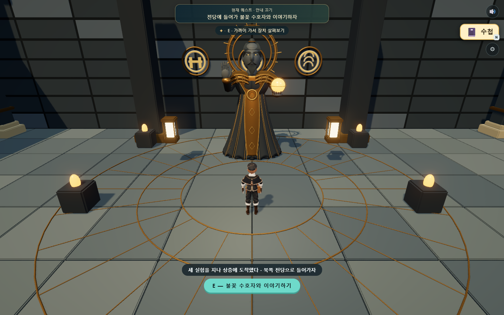

# 불의 신전 · 세 실험부터 수호자·퇴장까지

2026-10-21 / 웹 Three.js 0.160.0 / 로컬 구현·검증 결과

## 완성한 범위

본편 `index.html`의 화산 신전을 새 동선으로 교체했다. **균열 회랑 → 용암 주조실 → 증기 승강실 → 불꽃 수호자 전당 → 지혜 기록 → 행성으로 자동 퇴장·밀봉**까지 이어진다. 별도 시제품 `fire-trial.html`도 같은 방과 종료 상태를 사용한다.

- 회랑: 두 받침을 직접 옮겨 고정하고 시험한 뒤 다리를 건너 잠근다.
- 주조실: 두 수로를 연결하고 용암을 모은다. 공급을 끊어 굳힌 길로 건너가 잠근다.
- 승강실: A로 두 날개 다리를 내려 잠그고 B로 바꾼다. 승강대에 직접 탑승해 3.2m 상층으로 이동한다.
- 전당: 앞의 세 성취가 있어야 열린다. 추가 정답 퍼즐 없이 수호자에게 E로 말을 건다.
- 대화: 자동으로 넘기지 않는다. E·클릭·터치로 넘기며 읽는 동안 캐릭터와 장치 시간이 멈춘다. 건너뛰기도 가능하다.
- 종료: 네 문장을 마치면 구슬 연출 후 보상을 한 번 기록한다. 본편에서는 행성으로 나가고 입구가 밀봉된다. 시제품은 입구 안전 바닥으로 돌아간다.
- 필수 목표와 선택 가능한 황금 가루를 새 동선에 연결했다. 상층에서는 실제 3.2m 바닥 높이를 따라간다. 낮은 화질에서는 전당 동적 조명도 줄인다.

## 레퍼런스와 Blender 제작

[수호자 목표 이미지](../../art/fire-temple/sanctum-v01/guardian-reference.png) · [실제 GLB 회전·비교 화면](../../art/fire-temple/sanctum-v01/review.html) · [설계 계약](../../art/fire-temple/sanctum-v01/DESIGN.md)

현무암 노인·긴 로브·청동 어깨 장식·열린 축복 손·호박빛 구슬·태양 후광을 기준으로 제작했다. 전당 바닥의 세 실험 문양, 원형 금속 상감, 조명과 입구를 포함한다. 얼굴은 독립된 볼 덩어리처럼 보이던 첫 결과를 비판적으로 검토해 연속된 조각으로 합치고 형태를 정리했다. 볼·코·눈두덩을 별도 구체로 쌓는 대신 하나의 연속 곡면으로 다시 만들고 웹용으로 내보냈다.

| 실측 | 결과 |
|---|---:|
| 수호자 자체 밑면 | y=0 |
| 전당 보행 바닥·배치 높이 | y=3.2m |
| 후광 포함 자체 최고점 | 5.048563m |
| 수호자 삼각형 | 211,496 |
| 전당 고정 건축 삼각형 | 44,936 |
| 별도 눈·구슬 삼각형 | 2,880 / 3,792 |
| 전당 카메라 벽 내부 검사 | 36개 시점, 내부 0 |

편집 원본: `art/fire-temple/sanctum-v01/sanctum-v01.blend`. 재생성: `tools/blender/build_fire_guardian_v01.py`. 배포용 모델은 `assets/models/fire-temple/sanctum-*-v01.glb` 네 개와 manifest다. 이미지 생성 프롬프트·원본 시안도 보존했다.

**시안과 실제 결과는 같다 하지 않는다.** 큰 실루엣과 손·구슬·후광 배치는 반영했다. 실제 모델은 기존 게임에 맞춘 단순 재질이며, 목표 시안의 고해상도 돌 표면, 의복 조각, 손과 얼굴의 사실적인 미세 묘사에는 차이가 크다. 다음 그래픽 개선은 PBR 질감 굽기와 손 조각, 방 벽의 반복을 줄이는 암반 조형에 집중하는 편이 효과적이다. 기능 완주와 이 그래픽 수준의 차이는 별개다.

## 저장과 기존 기록 보존

본편 키 `mumuplanet.progress.v1`은 유지한다. 불의 신전 기록만 `version:3` 어댑터로 바뀐다. 구형 `version:1`의 세 완료 구간을 새 세 구간의 안전한 완료 상태로 대응하고, 보상을 이미 얻은 기록은 밀봉 상태로 유지한다. **구형 원문은 새 기록의 `legacyFire`에 남는다.** 다른 신전·채집·요리·수첩 기록을 초기화하지 않는다.

대화 중 저장은 정확한 문장 번호를 남긴다. 보상 연출 중 복원해도 한 번만 지급하고 퇴장한다. 전체 검사를 마친 상태만 적용해 손상된 뒤쪽 데이터가 앞쪽 장치를 부분 변경하지 않게 했다.

시제품은 별도 키 `mumuplanet.fire-trial.v3`을 사용한다. v2·v1·최초 회랑 기록을 읽어 이관하고 이전 키와 원문 보관본을 유지한다. 보관 키는 `mumuplanet.fire-trial.previous.v3`, 이관 원문 키는 기존 이름인 `mumuplanet.fire-trial.before-steam.v1`을 계속 사용한다. 시제품은 본편 저장을 읽거나 바꾸지 않는다.

## 이번 코드에서 다시 확인한 검사

격리된 Edge·Playwright를 사용했다. 본편 입장 준비 이후에는 컨트롤러에 이동·E 입력을 주어 실제로 걸었다. 퍼즐 완료 플래그를 만들어 완주한 것으로 세지 않았다. 저장 이관·대화 복원 검사는 별도 명시한 테스트 자료를 사용했다. 실제 사용자 브라우저 저장은 검사에 사용하지 않았다.

| 검사 | 결과·근거 |
|---|---|
| 회랑 회귀 | [33/33](../2026-10-20/evidence/fire-fracture/report.json) |
| 주조실 회귀 | [33/33](../2026-10-20/evidence/fire-foundry/report.json) |
| 증기실 회귀 | [37/37](evidence/fire-steam/report.json) |
| 본편 처음부터 전당·보상·퇴장 | [27/27](evidence/fire-adventure/report.json) |
| 구형 다섯 진행 상태·원문·원자적 거부·시제품 v2 이관 | [21/21](evidence/fire-adventure/migration.json) |
| 시제품 대화·수첩·재시작·중복 방지 | [12/12](evidence/fire-adventure/preview.json) |
| 보상 커밋 제거 고장 주입 | [예상대로 실패](evidence/fire-adventure/failure-injection.json), 자동 퇴장·보상 검사에서 검출 |
| 기본 소스·저장·음향·상태 검사 | 통과 |
| 시안/실제 회전 검수 화면 | PC·390px 너비·얼굴 확대·모델 로드 오류 없음 |

합계 **163개 기능 검사**를 통과했다. 본편 검사는 390×844·844×390 터치 대화, 대화/보상 중 재접속, 36개 전당 카메라 시점, 낮은 화질 조명, 실제 높이의 황금 가루, 보상 후 밀봉 복원도 포함한다.

명령과 준비 순서는 [검사 안내](../../tools/TESTING.md)를 따른다. 학생들이 재미있어하는지와 실제 학생 휴대폰의 프레임·발열·메모리 안정성은 아직 입증하지 않았다.

## 전체 게임 공통 검사에서 남은 것

`tools/check-github-integration.cjs`는 이번에 전체 통과하지 않았다. 새 화산은 분기·높이 동선 전용 검사를 사용하도록 공통 검사 계약을 정리했다. 공통 검사에서 물 위치를 일반 객체로 보내던 부분도 실제 `Vector3`로 고쳤다. 이후 다음 세 실패가 남았다.

- F: 물 신전이 예전 직선 관통 검사에서 첫 구간에 막힌다. 현재 물 신전의 상태 변화·점프 경로 검사는 별도 도구를 사용해야 한다.
- M: 360×440의 작은 수첩 창에서 일부 탭 내용이 높이를 넘는다.
- T: 범선의 소포 회수 상태를 준비하지 않은 기존 엔딩 검사에서 보내기 동작에 도달하지 못한다.

[공통 검사 출력](../2026-09-09/evidence/github-integration/selftest.txt). 공통 검사 실행 전후 전체 저장·화질이 유지되는 것은 확인했으나, 위 실패를 통과로 보고하지 않는다. 이번 불의 신전 완료 범위 밖의 후속 검토 항목이다.

## 완료 범위의 경계

세 실험·전당·수호자·대화·본편 저장 이관·일회 보상·자동 퇴장·밀봉과 로컬 검증을 완료했다. 이번 결과를 GitHub에 올리거나 Vercel에 새로 배포하지는 않았다. 기존 공개 사이트와 로컬 결과를 동일한 버전으로 보지 않는다.
