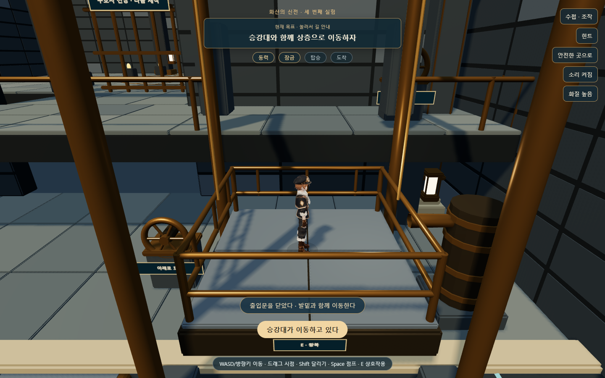
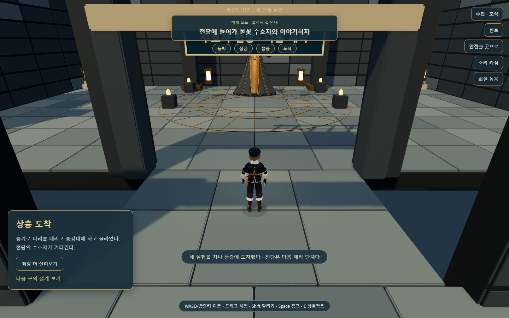

# 화산 신전 · 증기 승강실과 상층 연결

2026-10-21 / 웹 Three.js 0.160.0 / 로컬 시제품

## 결과

균열 회랑·용암 주조실 다음에 **증기 승강실**을 연결했다. 주조실을 마치고 중앙 홀로 돌아오면 북쪽 문이 열린다. [세 구간 플레이](http://127.0.0.1:5512/fire-trial.html) · [제작 기준·도면](../../art/fire-temple/steam-v01/DESIGN.md).

**다리로 동력 공급 → 두 날개 하강·영구 잠금 → 승강기로 동력 전환 → 직접 탑승·출발 → 3.2m 상층 하차 → 상층 통로까지 보행**을 구현했다. 첫 상승 전에는 빈 승강대가 스스로 올라가지 않는다. 상단에 도착하는 것만으로 완료하지 않고 실제 통로까지 걸어가야 한다.

## 실제 플레이

| 상황 | 동작 |
|---|---|
| 분기 밸브를 A로 조작 | 배관 표시·터빈이 움직이고 양쪽 다리 날개가 내려옴 |
| 하강 중 B로 전환 | 다리 정지. A에서 이어 내려오며 잠긴 다리는 다시 올라가지 않음 |
| 잠금 후 B로 전환 | 승강기 동력 준비. 빈 승강대는 대기 |
| 서쪽 문으로 탑승하고 E | 두 출입 난간이 닫히고 승강대와 발밑이 같은 거리만큼 이동 |
| 상승·하강 중 점프/이동 | 점프 가능. 닫힌 난간 안에서 이동하며 착지 시 같은 승강대에 밀착 |
| 상단 정지 | 북쪽 문 개방. 발코니와 상층 통로까지 실제 보행 |
| 완료 후 호출·왕복 | 위/아래 손잡이로 빈 승강대 보내기·호출, 탑승 E 왕복 |
| 수첩 | 이동·터빈·다리·승강대 시간 정지 |
| 균열 추락 | 안전한 가까운 발판으로 복귀. 기존 두 방과 잠근 다리 보존 |

첫 탑승 경험 뒤에만 위로 빈 승강대를 보낼 수 있다. 위에 남은 플레이어가 승강대를 아래로 보냈더라도 다시 호출할 수 있으며, 아래에서도 같은 왕복을 사용할 수 있다.

하층과 상층의 x,z가 겹쳐도 현재 발 높이에 맞는 면을 고른다. 발코니 밑을 걸으면 y=0에 머물고 3.2m 위로 순간 이동하지 않는다. 승강대는 매 프레임 높이 차를 승객에게 전달한 다음 기존 컨트롤러의 이동·점프·착지를 진행한다.

## Blender 제작·실측과 비판적 수정

기존 [목표 조감도](../../art/fire-temple/v01/concept-overview.png)와 치수 설계를 확인한 뒤 [증기실 원본](../../art/fire-temple/steam-v01/steam-v01.blend)을 만들었다. 원래 지도·이전 두 방의 `.blend`는 보존했다.

- [Blender 제작 도구](../../tools/blender/build_fire_steam_v01.py)로 고정 건축·다리 날개·터빈·승강대·출입 난간 GLB 5개를 분리했다. 조작대·손잡이·문은 이전 Blender 키트를 재사용한다. [내보내기 기록](fire-steam-export.log).
- 다리 전체 폭 8m·길이 6.4m. 4m 날개 둘이 바깥 축에서 내려와 중앙을 잇는다. 닫힌 상태에도 두 날개 사이로 목적지와 승강기를 볼 수 있다.
- 다리·승강대의 실제 표면 y=0, 상층 3.2m. [기하 측정](../../art/fire-temple/steam-v01/geometry-check.json).
- 균열 위 터빈과 승강탑 앞쪽 지지대를 실제 균열 바닥 -3m까지 내려 공중에 뜬 받침을 남기지 않았다. 두 밑면도 내보내기 시 실측한다.
- 중앙 원형 홀과 북쪽 통로의 접선 연결에는 4cm 겹침 바닥을 실제 모델과 보행면에 함께 추가했다.
- 승강대·난간은 실제 높이에 함께 배치한다. 움직이는 다리의 카메라 충돌도 회전과 함께 변한다. 상층의 보행 안내는 y=3.3으로 해당 바닥 위를 따른다.
- 기존 한 장짜리 올라간 다리가 첫 화면을 막았다. 두 날개로 나눠 터빈·균열·발코니·승강기가 함께 보이게 했다.
- 승강대의 구조 바닥과 포장 표면이 y=0에서 겹쳐 줄무늬가 생겼다. 구조판 상단을 -0.09m로 내려 실제 캡처에서 제거를 확인하고 실측 검사에 넣었다.
- 전면의 큰 안내판은 캐릭터를 가렸다. 승강대 앞의 작은 명판으로 옮겼다. 탑승 출발 시 시점이 북쪽 출입구를 향하고, 이후에는 사용자가 드래그할 수 있다.
- 상층 통로의 낮은 인방은 화면 위를 덮었다. 개구부를 4m로 높이고 카메라 충돌을 맞췄다.
- 닫힌 배관과 희미한 배출 김으로 동력을 표현한다. 이 김은 응결한 물방울의 시각 효과다. 동작 줄이기·낮은 화질에서 입자는 숨기며 압력 표시와 기계 움직임은 남는다.

목표 이미지의 풍화·조각·미세 재질까지 완성된 상태는 아니다. 현재는 세 방의 조작·높이·왕복·저장을 실제로 연결한 시제품이다. 실제 학생 기기의 로딩 시간·FPS와 재미는 아직 확인하지 않았다.

## 저장과 이관

| 용도 | 키 |
|---|---|
| 현재 세 방 저장 | `mumuplanet.fire-trial.v2` / 내부 version 2 |
| 새 게임 전 보관 | `mumuplanet.fire-trial.previous.v2` |
| 두 방 원본 | `mumuplanet.fire-trial.v1` — 읽어 이관하고 수정하지 않음 |
| 이관 전 추가 사본 | `mumuplanet.fire-trial.before-steam.v1` — 다른 사본이 있으면 접미사로 보존 |
| 최초 회랑 원본 | `mumuplanet.fire-fracture.v1` — 읽기만 함 |
| 본편 | `mumuplanet.progress.v1` — 이번 시제품에서 읽거나 쓰지 않음 |

새 키를 사용해 예전 탭이 구형 키에 저장해도 새 세 방 진행을 덮어쓰지 않는다. 이관 전 사본 보관에 실패하면 원본을 수정하지 않고 저장 실패를 알린다. 기존 초기 회랑·두 방 기록과 이번 작업 중 이전 키에 기록한 version 2도 이어받는다.

움직이는 다리는 닫힌 안전 상태로, 이동 중인 승강대와 승객은 출발 정지점으로 복원한다. 이미 잠근 다리·상층 도착·앞선 두 방은 유지한다. 빈 승강대를 호출하던 사용자는 자신의 실제 층에 복원한다. 전체 상태를 검증한 뒤 적용하고, 불가능한 잠금·높이·방 간 진행은 일부 적용 없이 거부한다.

## 검증

격리된 Edge에서 실제 `Input`·`RoomActor` 이동으로 입구부터 세 방을 연속 완주했다. 정상 완주를 순간 이동이나 완료 상태 생성으로 대체하지 않았다. 테스트는 해법을 알고 조향하며 학생의 재미 검토가 아니다.

| 검사 | 결과 |
|---|---|
| [증기실 검사](../../tools/check-fire-steam.cjs) | **37개 통과**, [결과](evidence/fire-steam/report.json) |
| 기존 회랑·주조실 회귀 | **각 33개 통과**, 총 **103개** |
| 발 밀착 | 컨트롤러 업데이트 전·접지 프레임의 측정 오차 0m. 상승·하강·기내 점프 포함 |
| 중간 기록 | 다리 하강 중·승강 중 실제 새로고침, 안정 지점 복원, 상층 완료 복원 |
| 하층·상층 | 발코니 밑에서 위로 이동하지 않음, 상층 출입구부터 통로까지 실제 보행 |
| 카메라 | 상층 36개 방향/각도에서 측정 벽 내부 진입 없음, 정면 후퇴 약 5.4m |
| 터치 | 문맥 E 출발, 승객과 승강대 함께 상승, 수첩 정지. 390×844·844×390·1024×768 표시 |
| 기존 데이터 | 두 방 원본과 사본 보존·용량 실패, 모순된 상태의 전체 거부, 본편 표식 불변 |
| 기본 | 소스 151개·로컬 import 396개·vendor 해시 19개, 기본 저장, 음향 7개 통과 |

[고장 주입 결과](evidence/fire-steam/failure-injection.json)는 테스트 브라우저에서 승객에게 전달한 이동량만 되돌린 것이다. 기존 컨트롤러가 뒤에서 발 높이를 보정하기 전에 **0.01333m 오차**를 잡아 예상 종료 코드 1로 실패했다. 마지막 렌더가 그럴듯한지만 확인한 검사가 아니다. 정상 코드와 사용자 기록에는 주입하지 않았다.

세 브라우저 검사를 동시에 실행하던 중 기존 회랑의 모바일 초기 로딩이 한 차례 90초를 넘겼다. 원인은 확정하지 못했다. 콘솔 오류 수집·빠른 시작 실패 판정을 보강하고 단독 재실행해 33개를 모두 통과했다. 새 증기실·주조실 터치 검사도 통과했으며 실기기 성능 확인은 남는다.

## 다음 단계

**수호자 전당**의 모델·대화·수첩 기록·보상 1회 지급·안전 퇴장이다. 현재 상층의 닫힌 문은 그다음 작업 범위를 표시한다. 수호자 이벤트, 구슬 지급, 본편 불 신전 교체·기존 본편 기록 이관은 아직 구현하지 않았다.

이번 작업은 로컬 구현이며 GitHub 업로드·Vercel 배포는 실행하지 않았다.
